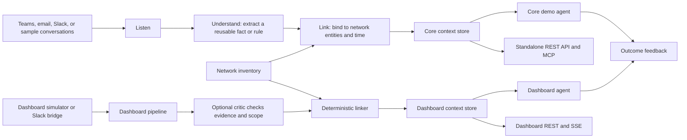

# ElidEx

**Capture the Hidden Knowledge that lives in network operation conversations, connect it to the right equipment and time, and make it re-usable by an AI agent.**

Built by the **The Trappists** team for the **Since AI Hackathon 2026** in Turku, Finland.

[](https://www.python.org/)
[](https://fastapi.tiangolo.com/)
[](https://sinceai.app/)
<!-- TODO: add complete stack -->

## The challenge

Elisa's challenge is **“Capturing and Linking Human-Generated Contextual Metadata for Autonomous Network Operations.”** Network specialists already share practical knowledge in chats and emails, but that knowledge is hard for an autonomous agent to find later as it is not made persistent through documentation. ElidEx captures the reusable rule or fact, binds it to network entities and a validity period, records its source and trust, and makes it available when a similar case comes up.

The demo follows the challenge's SFP example: after a module swap, a link can look healthy while traffic counters stay at zero. The conversation contains a practical next step from an expert. The agent can retrieve that human advice on a similar case and cite the assertion it used.

The project focuses on **human knowledge and its reuse** to reduce professional's workload. Fault detection and root-cause analysis are outside the challenge scope. See [the challenge brief and scope checklist](docs/challenge.md) for details.

## Get started

### Requirements

- [uv](https://docs.astral.sh/uv/) for Python dependency and command management.
- Python 3.12 or newer. `uv` can install the project interpreter when needed.
- Node.js 22 and npm only if you want the Dashboard web UI.

### Install and run the core

```bash
git clone https://github.com/The-trappists/since-ai-hackathon.git
cd since-ai-hackathon
uv sync

# Build the context store from the included sample conversations and cached extractions.
uv run ctx run --lifecycle

# Inspect captured context and run the sample agent.
uv run ctx context TRN-117 --at 2026-10-20T08:00
uv run ctx agent --conditions --guard
```

The core example runs without a live model key. By default, extraction replays the checked-in cache so the demo is repeatable. To call a model, copy `.env.example` to `.env`, add your provider details, then run `uv run ctx run --llm`. Keep `.env` local; never commit credentials.

### Run the Dashboard

The Dashboard is the team's interactive test bench. Build the frontend once, then start the API and UI together:

```bash
cd web
npm ci
npm run build
cd ..
uv run ctx dashboard
```

Open [http://127.0.0.1:8010](http://127.0.0.1:8010). The Dashboard starts with seeded network data and scenarios. It can run in scripted mode without an LLM key. For frontend development with hot reload, leave the backend running and use `npm run dev` in `web/`; the dev server proxies API requests to port 8010.

### Other useful commands

```bash
uv run ctx eval                 # evaluate extraction and retrieval
uv run ctx graph stats          # inspect the knowledge graph
uv run ctx serve                # standalone REST API at http://127.0.0.1:8000
uv run ctx mcp                  # MCP tools over stdio
```

The commands above also work in PowerShell; install [uv](https://docs.astral.sh/uv/) and, for the Dashboard UI, Node.js 22 with npm. For optional Neo4j, Slack, and deployment instructions, see the [deployment guide](docs/deploy-vultr.md), [Slack setup](docs/slack-setup.md), and [Dashboard guide](docs/dashboard.md).

## How it works



1. **Listen:** Load conversation threads from the sample data, the Dashboard simulator, or its optional Slack bridge. The challenge's key requirement is to use the conversations people already have, without asking specialists to fill out a separate form.
2. **Understand:** An extractor returns structured assertions: a summary, conditions, action or fact, cited messages, author, trust level, confidence, and scope. It can use cached results, scripted scenario data, or a configured LLM.
3. **Check and link:** In the Dashboard, an optional critic checks the evidence and whether the extracted scope is too broad. A deterministic linker resolves equipment, sites, equipment classes, and triggers against the inventory; when it cannot link safely, it can abstain.
4. **Store and reconcile:** Assertions include source provenance and `valid_from` / `valid_to`. The NetworkX-backed context store supports time-aware retrieval, conflicts, lifecycle updates, and a graph view. Optional hooks compare new assertions and update trust from agent outcomes.
5. **Reuse:** An agent retrieves context for an entity and case, checks machine-readable conditions when observations are available, and returns a recommendation with assertion citations. REST and MCP interfaces expose context and graph tools to other clients.

The main shared data contract is in [`src/context_layer/models.py`](src/context_layer/models.py). Core pipeline stages live under [`src/context_layer/`](src/context_layer/); the live team test bench is in [`src/context_layer/dashboard/`](src/context_layer/dashboard/). The CLI-built store (`out/context_store.json`) backs the standalone REST and MCP interfaces. The Dashboard runs its own live store and persists it separately under `out/dashboard/`; its REST and SSE endpoints serve that Dashboard state. See [the design](docs/design.md), [Dashboard API](docs/dashboard.md), and [evaluation notes](docs/evaluation.md) for more detail.

## Project contents

| Path | What's inside |
| --- | --- |
| [`data/elisa/`](data/elisa/) | Elisa's example conversation and challenge material |
| [`data/synthetic/`](data/synthetic/) | Synthetic conversations, network inventory, and cases |
| [`src/context_layer/`](src/context_layer/) | Extraction, entity linking, storage, agent, REST and MCP services |
| [`src/context_layer/dashboard/`](src/context_layer/dashboard/) | Live state, pipeline processor, simulator, Slack bridge, and API |
| [`web/`](web/) | React, TypeScript, and Vite Dashboard interface |
| [`docs/`](docs/) | Challenge, design, decisions, evaluation, deployment, and data documentation |


## Contributors

Contributors credited in the Git commit history include **Bilal Vandenberge** (`jaketherealone`), **Manuel Rocca** (`mnlrc`), **Haluk Yilmaz** (`maybe`), and **Matteo Morbée** (`UnPtitBelge`). Git author aliases may refer to the same person. Contributions and design choices are documented in [the decision log](docs/decisions.md); see [CONTRIBUTING.md](CONTRIBUTING.md) for collaboration conventions.

## Hackathon and license context

This project was created for the **Since AI Hackathon 2026**, held in Turku, Finland, on 6–8 November 2026. It addresses Elisa's challenge; the challenge brief states that the team owns its output and grants Elisa a perpetual, non-exclusive, royalty-free license to use it. See [the challenge summary](docs/challenge.md) and the original [challenge brief](docs/elisa/challenge-brief.pdf).

**This repository does not currently include a standalone `LICENSE` file.** The challenge's license terms above describe Elisa's use rights; they do not specify a general open-source license for this repository. Contact the project team before reusing the code under other terms.

## Further reading

- [Challenge and scope](docs/challenge.md)
- [Design and assertion schema](docs/design.md)
- [Recorded decisions](docs/decisions.md)
- [Evaluation](docs/evaluation.md)
- [Dashboard guide](docs/dashboard.md)
- [Synthetic dataset guide](docs/dataset.md)
- [Contributing](CONTRIBUTING.md)
