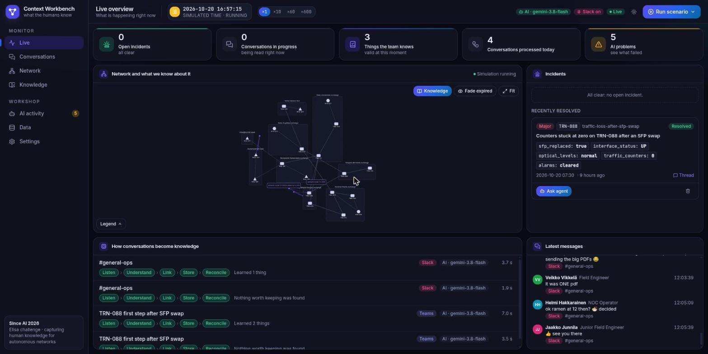
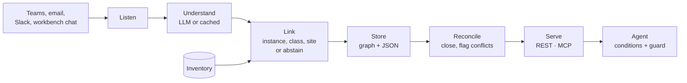
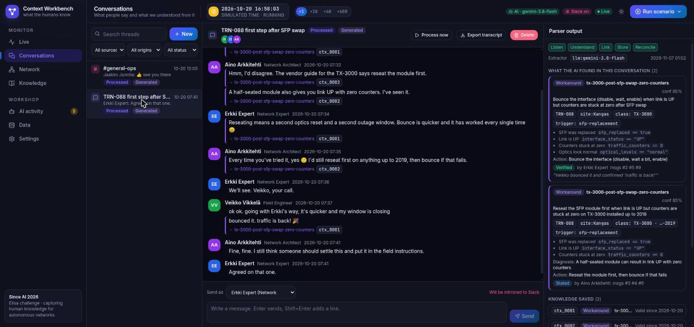
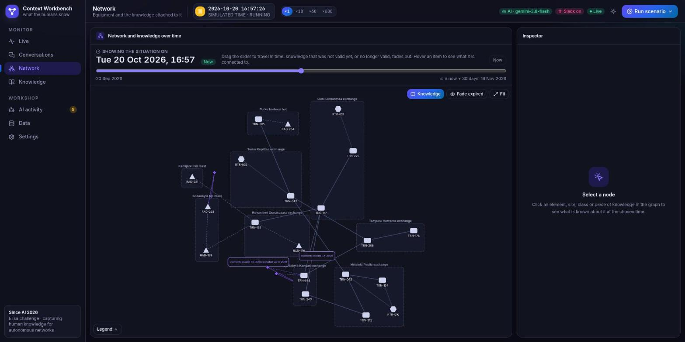
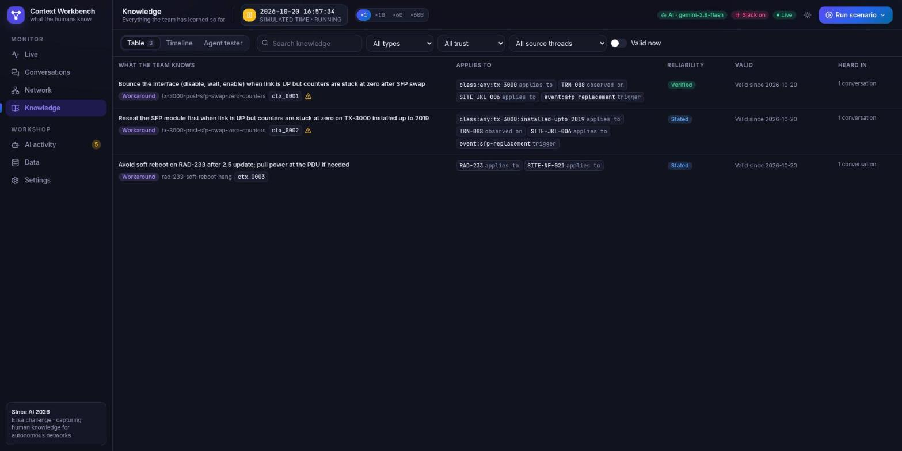
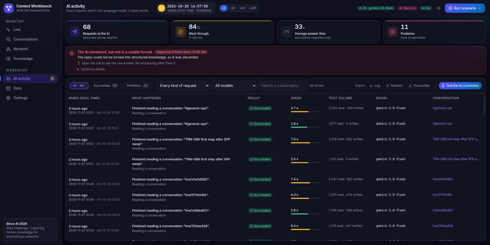
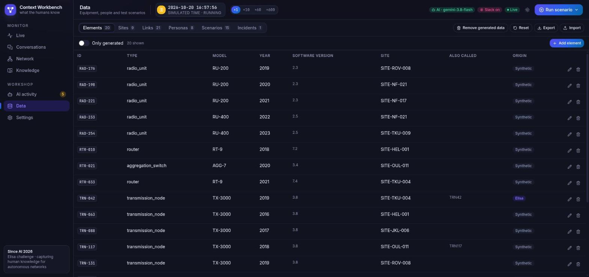
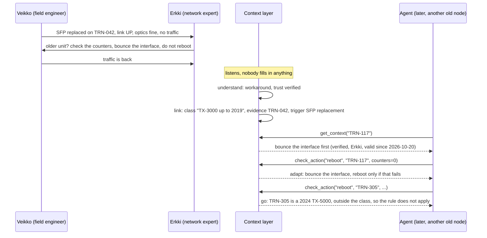

<div align="center">
  <h1>Context Layer — Since AI 2026</h1>
  <p><strong>Capturing the knowledge humans share in chats and emails, and giving it to AI agents.</strong></p>
  <p>Our answer to Elisa's challenge <em>"Capturing and Linking Human-Generated Contextual Metadata for Autonomous Network Operations"</em></p>
</div>



## Contents

1. [The problem](#the-problem)
2. [What we built](#what-we-built)
3. [How it works](#how-it-works)
4. [The Context Workbench](#the-context-workbench)
5. [Worked example: Erkki and the silent SFP](#worked-example-erkki-and-the-silent-sfp)
6. [The four angles: A, B, C, D](#the-four-angles-a-b-c-d)
7. [Data: what is Elisa's, what is ours](#data-what-is-elisas-what-is-ours)
8. [Quick start](#quick-start)
9. [Configuration](#configuration)
10. [Repository map](#repository-map)
11. [Deployment and Slack](#deployment-and-slack)
12. [Tests and CI](#tests-and-ci)
13. [Scope and honest limits](#scope-and-honest-limits)
14. [Documentation index](#documentation-index)
15. [Team and license](#team-and-license)

## The problem

Elisa's autonomous network operations know what the network **is** (design), **was built as** (inventory) and **does** (telemetry). They do not know what the humans **know about it**.

> A field engineer replaces an SFP on a transmission node. Link UP, optics normal, alarms cleared, but no traffic. He asks a senior expert on Teams. The expert answers: older unit, don't trust the green status, check the counters, bounce the interface, don't reboot. Traffic is back. *"Is this documented somewhere?" "Not that I know of 😄".*

That smiley is the problem: an AI agent cannot call the expert at 3 a.m. The guiding question of the challenge is **how to collect this silent knowledge without creating extra work for specialists**. If the solution needs Erkki to fill in a form, Erkki won't fill in the form.

## What we built

A **context layer**: the "as-experienced" layer that sits next to Elisa's design, inventory and runtime layers.

1. **Listens** to the channels people already use (Teams, email, Slack). Nobody types anything extra and nobody clicks "confirm".
2. **Understands** a conversation and keeps the one sentence of real knowledge (a workaround, a site access detail, a correction), or nothing when it is chit-chat.
3. **Links** it to the right network entity: the node, the class of nodes ("TX-3000 installed up to 2019"), the site, the trigger event. A wrong link is worse than none, so it abstains when unsure.
4. **Stores** it as a machine-readable *context assertion* with a validity period (`valid_from` / `valid_to`), a trust level (hunch, stated, verified), its sources and its conflicts.
5. **Keeps it true over time**: a later message closes obsolete knowledge, two experts who disagree are both kept and flagged, "traffic is back" upgrades a hunch. Again with no human in the loop.
6. **Serves it to agents** through REST and MCP, with a guard ("reboot TRN-117" becomes "bounce the interface first") and a condition checker (the rule fires only when the observed state matches).

On top of the core, we built the **Context Workbench**: a deployed, real-time test bench where fake (or real, through Slack) colleagues chat and the team watches knowledge appear on a network graph.

| Piece | What it is | Command |
| --- | --- | --- |
| Core pipeline | `listen → understand → link → store`, CLI, REST API, MCP server | `ctx run`, `ctx serve`, `ctx mcp` |
| MVP starters | Guard (B), conditions (C), lifecycle (D) | flags on `ctx run` / `ctx agent` |
| Context Workbench | Live UI, simulator, Slack bridge, LLM log | `ctx workbench` |
| Streamlit demo | Simple pitch-style demo on the synthetic cases | `streamlit run demo/app.py` |

## How it works



A context assertion, in short (full schema in [docs/design.md](docs/design.md)):

```json
{
  "id": "ctx_0001",
  "type": "workaround",
  "topic": "tx-3000-post-sfp-swap-zero-counters",
  "bound_to": [
    {"entity": "class:transmission_node:tx-3000:installed-upto-2019", "role": "applies_to"},
    {"entity": "TRN-042", "role": "observed_on"},
    {"entity": "event:sfp-replacement", "role": "trigger"}
  ],
  "conditions": [{"text": "traffic counters stuck at zero", "check": {"field": "traffic_counters", "op": "==", "value": 0}}],
  "action": "Bounce the interface (disable, wait, enable)",
  "avoid": ["replace the SFP again", "reboot the unit"],
  "valid_from": "2026-10-20T09:22:00", "valid_to": null,
  "trust": {"level": "verified", "stated_by": "Erkki Expert", "evidence": "'Traffic is back'"},
  "sources": [{"source": "teams", "file": "elisa/teams_chat.json", "seq": [2, 4, 6, 8, 10]}]
}
```

Why it is built this way:

| Elisa's hard point | Our answer |
| --- | --- |
| The real knowledge is one sentence in twelve messages | One LLM call per thread with a strict prompt; returns nothing for noise; evaluated against scenarios with ground truth |
| Linking: "these older units" means what? | Class criteria (type, model, install-year range) as scope, the instance as evidence; too-broad or unmatched classes are not bound; abstains below `MIN_CONFIDENCE` |
| Time | `valid_from` / `valid_to`; an invalidation message closes older knowledge on the same topic and scope |
| Trust | `hunch` / `stated` / `verified`, who said it, in which role, with the evidence message; disagreements are kept side by side with `conflicts_with` |
| People | Passive capture only; the UI shows *the knowledge*, with its source, never a task for the specialist |

All diagrams (pipeline, data model, linking, lifecycle, workbench, deployment, code map) are in **[docs/architecture.md](docs/architecture.md)**.

## The Context Workbench

The Workbench is the team's real-time test bench (it is a work tool, not the pitch demo). One Python process serves a REST API, an SSE event stream and a React UI. Open it, start a scenario and watch a conversation become knowledge.

### Live: the control room


Open incidents, conversations in progress, things the team knows right now, AI problems. The centre shows the network with the knowledge attached to it. Below, each conversation flows through `Listen › Understand › Link › Store › Reconcile` with its duration and result; on the right, the latest chat messages. A **simulated clock** (×1 to ×600) and a **Run scenario** menu drive the show.

### Conversations: what people said and what the AI understood



Each message that carries knowledge is tagged with the assertion it fed (`ctx_0001`). The right panel shows the parser output: type, scope (`TRN-088`, `site:Kangas`, `class: TX-3000`), conditions as machine checks, action, trust and the quote that justifies it. You can post as any persona, process a thread on demand, and export a transcript. Here, Erkki's bounce (verified: "bounced it. traffic is back!") and Aino's reseat-first advice (stated) are **both kept** and flagged as a disagreement.

### Network: knowledge over time



Sites (boxes), transmission nodes, radios and routers, with links. Knowledge appears as small nodes attached to the elements and classes it covers. A **time slider** shows the situation on any date: knowledge not yet valid, or no longer valid, fades out. Click anything to inspect it.

### Knowledge: the context store



Table and timeline views, filters by type, trust, source thread and "valid now". A warning triangle marks assertions that conflict with another. An **Agent tester** tab asks the demo agent what it would do on a case.

### AI activity: every LLM call, in plain words



Request count, success rate, average latency, problems. Failures are explained in plain language ("The AI answered, but not in a usable format"), with the raw answer under *Technical details*. Export the log, the session or the transcripts. **Test the AI connection** runs the same check as `ctx llm-check`.

### Data: inventory, people, scenarios



Elements, sites, links, personas, scenarios and incidents are all editable. **Reset** restores the seed, or starts empty to watch knowledge being built from scratch; **Remove generated data** cleans up what scenarios created; Export / Import moves the whole state.

### Settings

Extractor mode (`auto`, `llm`, `scripted`), lifecycle, conditions and guard toggles, idle time before a thread is processed, Slack mirroring, auto-simulation.

### Scenarios

15 scripted scenarios, each testing one thing (see [data/workbench/README.md](data/workbench/README.md)):

| Scenario | Tests |
| --- | --- |
| `elisa-trn042-chat`, `elisa-trn042-email` | Elisa's material replayed word for word: capture and merge of chat + email |
| `similar-trn117`, `new-unit-trn305` | Reuse on a similar old node, and **no** reuse on a newer unit (no overlinking) |
| `barrier-key-kemijarvi`, `slack-key-moved` | Site access knowledge, and its correction closing the old one |
| `firmware-4-2-rollout` | Lifecycle: a fix closes the rule |
| `expert-disagreement` | Two experts, two opinions, both kept |
| `hunch-to-verified` | A hunch upgraded by a later outcome |
| `noise-chitchat`, `slack-needle-in-noise` | Precision: nothing (or one needle) in a lot of noise |
| `slack-radio-tilt`, `slack-noc-handover`, `slack-breaker-harbour-hut`, `slack-vendor-secondhand` | Realistic Slack conversations, different topics and trust levels |

**Incidents are scripted ground truth.** The Workbench never detects or diagnoses faults (out of scope); an incident only triggers a conversation and shows what the context layer knows about the element.

## Worked example: Erkki and the silent SFP



From the command line:

```bash
uv run ctx run                                     # Teams + email -> assertions (out/context_store.json)
uv run ctx context TRN-117 --at 2026-10-20T08:00   # what humans know about another old node
uv run ctx run --lifecycle && uv run ctx agent --conditions --guard
```

## The four angles: A, B, C, D

Elisa's brief asks for capture, linking and reuse. We implemented the shared core (A) and one thin, working starter for each other angle. All of them are flags, so they combine. See [docs/mvps.md](docs/mvps.md).

| | Angle | What it adds | Module | Turn it on |
| --- | --- | --- | --- | --- |
| **A** | Context layer for agents | Capture → link → store → `get_context(entity, at)` | core | always on |
| **B** | Ask-before-act guard | Checks a planned action against human knowledge: *go* or *adapt* | `mvp/guard.py` | `ctx agent --guard`, `POST /guard`, MCP `check_action` |
| **C** | Conditional rules | Conditions as machine checks on observable fields; the rule fires only when it applies | `mvp/conditions.py` | `ctx agent --conditions` |
| **D** | Knowledge lifecycle | Silent closing of obsolete knowledge, conflicts, trust upgrades | `mvp/lifecycle.py` | `ctx run --lifecycle` |

> No single angle has been formally chosen and logged yet; see [docs/decisions.md](docs/decisions.md) for what the team has decided so far. In the Workbench, B, C and D are on by default (Settings).

## Data: what is Elisa's, what is ours

| Item | Origin |
| --- | --- |
| Teams chat and email of the TRN-042 case, the node id `TRN-042`, Erkki Expert and Veikko Vikkelä | **Elisa** ([`data/elisa/`](data/elisa/)) |
| Dates for the chat (Elisa gives times only), TRN-042's model, install year and site | Our assumptions, documented |
| Everything else: other elements, sites, links, personas, scenarios, synthetic emails, Slack chats | **Synthetic**, written with AI assistance and reviewed by the team |

How each synthetic file was made: [data/synthetic/README.md](data/synthetic/README.md) and [data/workbench/README.md](data/workbench/README.md). Extractions of the static files are cached in `data/cache/` so the core demo runs offline and deterministically.

## Quick start

Needs [uv](https://docs.astral.sh/uv/) (Python 3.12) and, for the UI, Node 22.

```bash
git clone <this repo> && cd since-ai
uv sync
cp .env.example .env              # optional: add an LLM key (see Configuration)

# Core, offline (cached extractions)
uv run ctx run                    # -> out/context_store.json
uv run ctx context TRN-117 --at 2026-10-20T08:00
uv run ctx agent                  # demo agent on data/synthetic/cases.json
uv run ctx run --lifecycle && uv run ctx agent --conditions --guard

# Workbench
(cd web && npm ci && npm run build)
uv run ctx workbench              # http://127.0.0.1:8010
#   UI with hot reload: cd web && npm run dev   (port 5173, proxies /api to 8010)

# Other interfaces
uv run ctx serve                  # REST API, docs at http://127.0.0.1:8000/docs
uv run ctx mcp                    # MCP server over stdio for agents
uv run streamlit run demo/app.py  # Streamlit demo
uv run ctx llm-check              # which LLM provider and JSON mode work with your .env
uv run pytest
```

### Command reference

| Command | Purpose |
| --- | --- |
| `ctx run [--llm] [--lifecycle]` | Run the pipeline on all threads in `data/` |
| `ctx context <entity> [--at ISO]` | What humans know about an entity at a time |
| `ctx agent [--conditions] [--guard] [--llm]` | Demo agent on the synthetic cases |
| `ctx serve` | REST API (`/context/{id}`, `/guard`, `/assertions`, `/health`) |
| `ctx mcp` | MCP tools `get_context` and `check_action` |
| `ctx workbench [--host] [--port]` | API + UI + simulator + Slack bridge |
| `ctx llm-check` | Ping each configured provider and test its JSON modes |

## Configuration

Config lives in `.env` (never committed; placeholders in [`.env.example`](.env.example)). Without any key, the core replays cached extractions and the Workbench runs in `scripted` mode.

| Variable | Role |
| --- | --- |
| `LLM_BASE_URL`, `LLM_API_KEY`, `LLM_MODEL` | Primary provider, any OpenAI-compatible endpoint (we use Gemini through AI Studio) |
| `LLM_JSON_MODE` | `json_object`, `json_schema` or `prompt`; `ctx llm-check` tells you which works |
| `LLM_REASONING_EFFORT` | Defaults to `low` for Gemini to cut latency |
| `LLM_FALLBACK_*` | Fallback provider (we use Featherless) when the primary fails with 429, 5xx or a timeout |
| `MIN_CONFIDENCE` | Extracted items below this are not stored (precision first) |
| `DEFAULT_THREAD_DATE`, `DEFAULT_EMAIL_TIME` | Elisa's material has no date: our assumption |
| `WORKBENCH_SIM_START`, `WORKBENCH_IDLE_SECONDS` | Start of the simulated clock; seconds of silence before a thread is processed |
| `SLACK_BOT_TOKEN`, `SLACK_APP_TOKEN`, `SLACK_CHANNEL_ID` | Optional Slack bridge |
| `DOMAIN`, `BASIC_AUTH_USER`, `BASIC_AUTH_HASH` | Deployment (Caddy HTTPS and team password) |

## Repository map

| Path | Content |
| --- | --- |
| `src/context_layer/` | Core: `listen`, `understand`, `llm`, `link`, `store`, `pipeline`, `agent`, `api`, `mcp_server`, `cli`, shared contract `models.py` |
| `src/context_layer/mvp/` | `guard.py` (B), `conditions.py` (C), `lifecycle.py` (D) |
| `src/context_layer/workbench/` | Backend: `state`, `processor`, `simulator`, `clock`, `generator`, `seed`, `persistence`, `bus`, `routes`, `app`, `slack_bridge`, `contracts` |
| `web/` | Workbench UI: React, Vite, TypeScript, Tailwind, Cytoscape |
| `data/elisa/` | Elisa's material (chat, email, use case, reference architecture) |
| `data/synthetic/` | Our synthetic inventory, messages and agent cases |
| `data/workbench/` | Workbench seed: topology, personas, 15 scenarios |
| `data/cache/` | Cached extractions for the offline demo |
| `demo/app.py` | Streamlit demo |
| `deploy/`, `Dockerfile` | Docker Compose + Caddy for the Vultr VM, Slack app manifest, update script |
| `tests/` | Linking, pipeline, workbench core and simulator, Slack bridge |
| `docs/` | Challenge, design, architecture, decisions, plan (see below) |

## Deployment and Slack

The team instance runs on a Vultr VM with Docker Compose and Caddy (automatic HTTPS, one team password). Pushing to the VM is `./deploy/update.sh`. The Slack bridge uses Socket Mode (no public URL): personas post with their own name and avatar, and teammates can answer in the channel as if they were the specialists. Step by step: [docs/deploy-vultr.md](docs/deploy-vultr.md) and [docs/slack-setup.md](docs/slack-setup.md).

## Tests and CI

`uv run pytest` covers linking (abstention, class generality), the end-to-end pipeline on Erkki's case, workbench state and simulator, and the Slack bridge. GitHub Actions runs `pytest` and, for the web app, `npm run typecheck` and `npm run build` on every push and pull request.

## Scope and honest limits

In scope: capturing knowledge from chat and email, binding it to entities with a validity period, trust and conflicts, reuse by an agent. Out of scope (see [docs/challenge.md](docs/challenge.md#scope-checklist)): Elisa's own workflows and systems, ticketing, **fault detection or root-cause analysis**, GDPR handling.

Limits you should know about:

- Elisa gave one case; everything else is synthetic. We do not claim a real integration with Elisa's systems.
- The guard's action vocabulary is a small verb list (`reboot`, `replace`, `dispatch`).
- Conditions only check a few observable fields (`sfp_replaced`, `interface_status`, `optical_levels`, `traffic_counters`, `alarms`).
- The store is NetworkX plus a JSON file; Neo4j or Spanner would be the next step.
- Linking relies on exact ids and aliases; no embeddings.
- LLM answers are sometimes not valid JSON (see the *AI activity* page); re-processing a thread usually fixes it, and `auto` mode falls back to scripted answers.
- The Workbench is a team tool: single process, one shared state, one password.

## Documentation index

| Doc | What's inside |
| --- | --- |
| [Architecture](docs/architecture.md) | **All diagrams**: pipeline, data model, linking, lifecycle, workbench, deployment, code map |
| [Challenge](docs/challenge.md) | The brief, the material, the scope checklist |
| [Ideas](docs/ideas.md) | The four candidate directions |
| [Design](docs/design.md) | Pipeline options and the context-assertion schema |
| [MVPs](docs/mvps.md) | What each angle does today and what is left |
| [Workbench](docs/workbench.md) | Contract, REST API, processing rules, UI conventions |
| [Plan](docs/plan.md) | 48 h plan, demo, risks, status |
| [Tech stack](docs/tech-stack.md) | Options and what we actually use |
| [Decisions](docs/decisions.md) | What the team decided, and why |
| [Deploy on Vultr](docs/deploy-vultr.md), [Slack setup](docs/slack-setup.md) | Operations |
| [Contributing](CONTRIBUTING.md), [AGENTS.md](AGENTS.md) | Workflow and rules for humans and AI assistants |

Elisa's material: [brief](docs/elisa/challenge-brief.pdf), [pitch slides](docs/elisa/sinceai-2026-challenge-pitch-elisa.html).

## Team and license

Built by the team at the Since AI hackathon, Turku, 6–8 November 2026. Per the challenge brief, the team owns the output and Elisa receives a perpetual, non-exclusive, royalty-free licence to use it. No open-source license has been chosen yet.
