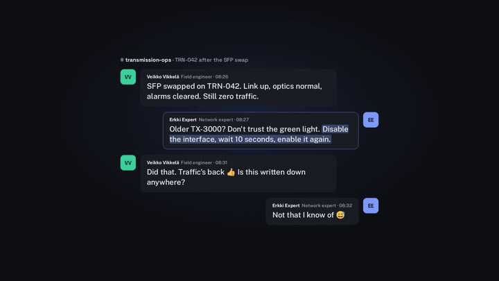
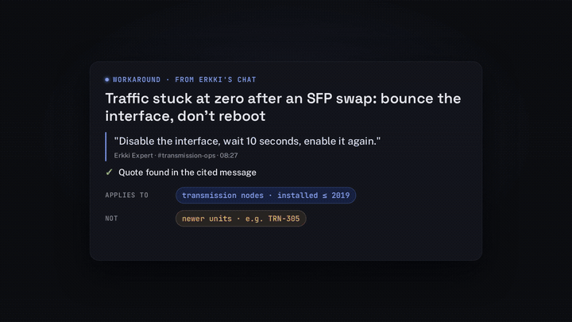
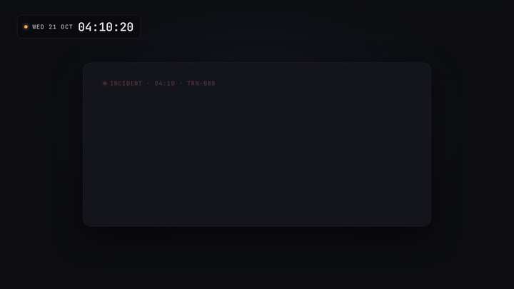
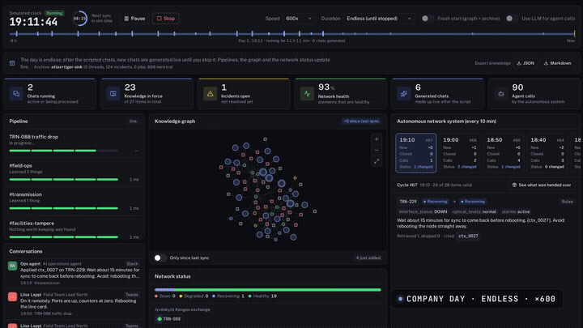
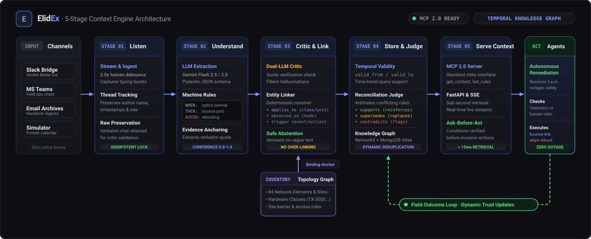
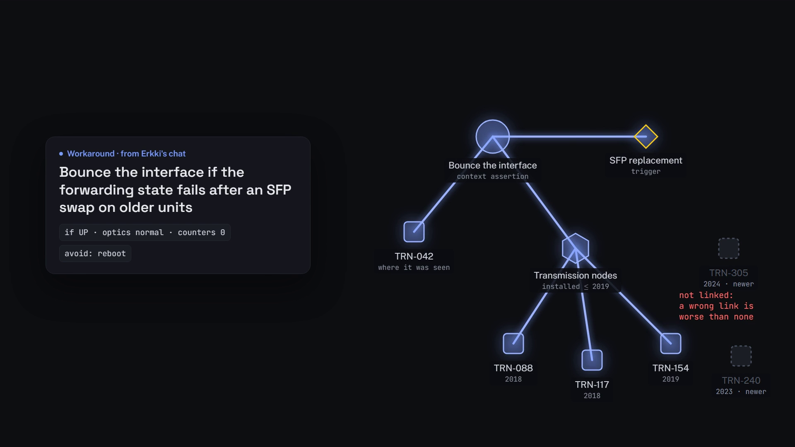
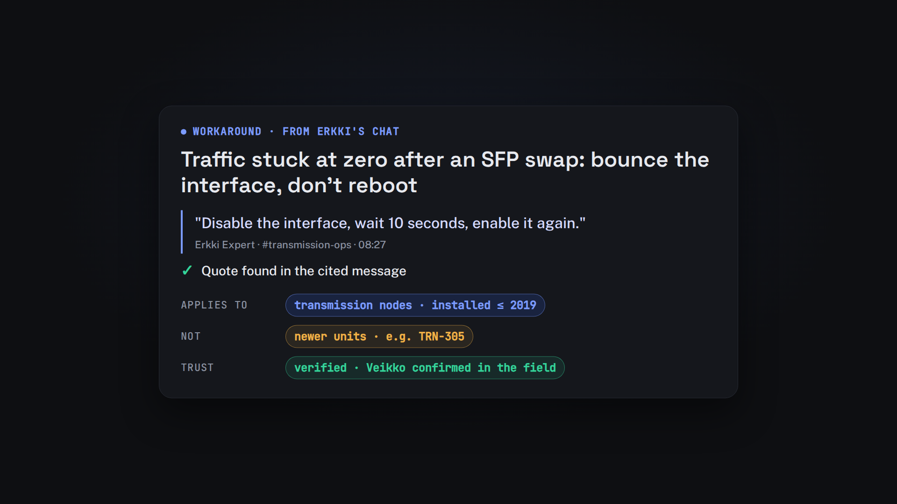
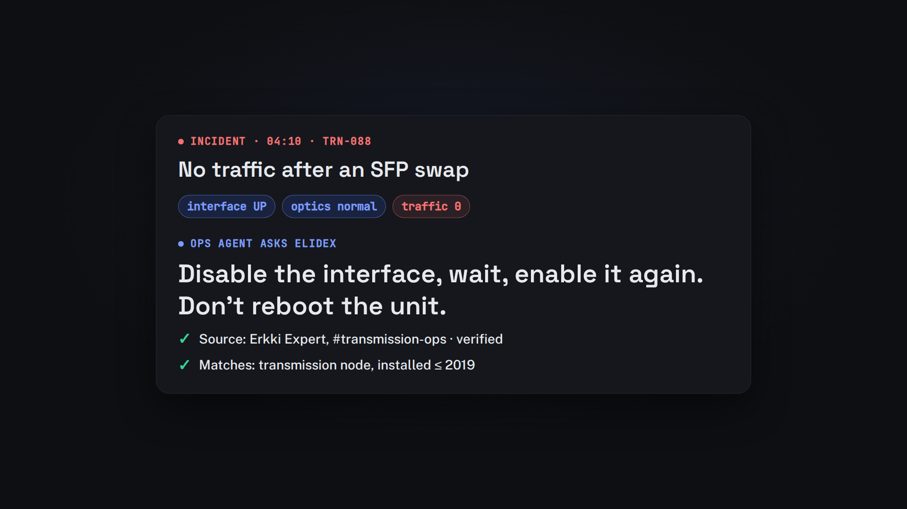
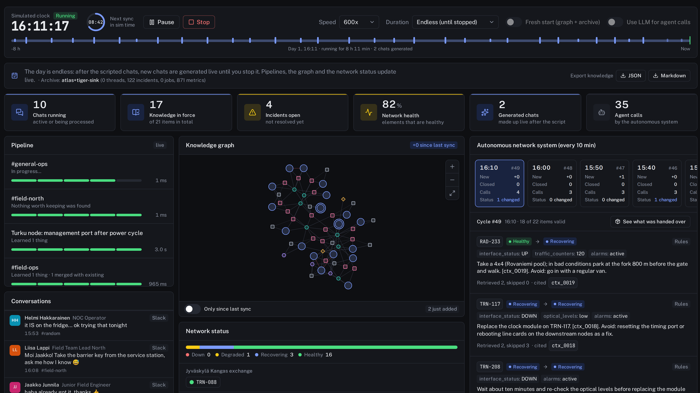

<div align="center">


# ElidEx

### *The "As-Experienced" Context Layer for Autonomous Network Operations*

**Capturing the unspoken operational know-how in engineering chats, binding it to network topology with time validity, and serving it to AI agents.**

Built by **The Trappists** for the **Since AI Hackathon 2026** (Turku, Finland)  
*Addressing Elisa’s Challenge: "Capturing and Linking Human-Generated Contextual Metadata for Autonomous Network Operations"*

---

[](https://www.python.org/)
[](https://fastapi.tiangolo.com/)
[](https://react.dev/)
[](https://www.typescriptlang.org/)
[](https://tailwindcss.com/)
[](https://deepmind.google/technologies/gemini/)
[](https://modelcontextprotocol.io/)
[](https://www.mongodb.com/atlas)
[](deploy/)
[](LICENSE)
[](https://sinceai.app/)

[**Watch Demo (YouTube)**](https://youtu.be/XQCUgTxHnx0) • [**Watch Demo Video (MP4)**](docs/video/ElidEx-demo-final.mp4) • [**Submission Report**](docs/submission.md) • [**Design & Architecture**](docs/design.md) • [**Decisions Log**](docs/decisions.md)

</div>

---

## 🎬 Project Showcase & Demos

### 1. Zero-Friction Capture & Live Extraction
Specialists talk on Teams, Slack, or email as they always do. ElidEx extracts actionable operational rules without asking engineers to fill in a form.



### 2. The Dynamic Knowledge Graph
Context assertions are deterministically bound to network entities, hardware classes, and sites with temporal validity (`valid_from` / `valid_to`).



### 3. Ask-Before-Act Guard (Agent Testing)
An autonomous AI agent encounters an incident at 3 a.m. Instead of initiating a disruptive reboot or replacing hardware, it consults human wisdom through **MCP**, checks traffic counters, and bounces the interface.



### 4. Insights & Cross-Topology Pattern Recognition
ElidEx correlates workarounds across time and network topology to uncover **recurring problems** and **linked incidents with hidden common causes**.



---

## 💡 The Problem: *"Not that I know of 😄"*

Modern telecom network automation already understands:
- **Intent (as-designed):** How the network was planned.
- **Physical (as-built):** The hardware installed.
- **Runtime (as-running / telemetry):** Alarms, metrics, and traffic flows.

**What is missing is the Context Layer ("as-experienced"):**
> *A field engineer replaces an SFP on a transmission node. Link UP, optics normal, alarms cleared, but no traffic flows. He asks a senior expert on Teams. The expert advises: older unit, don't trust the green link status, check counters; if zero, bounce the interface before rebooting or swapping hardware. Traffic recovers.*  
> *"Is this documented somewhere?" — "Not that I know of 😄".*

That smiley is the bottleneck for autonomous network operations. An AI agent cannot call senior engineers at 3 a.m. 

### Elisa's Core Principles Respected:
- **Zero specialist overhead:** *"If your solution needs Erkki to fill out a form, Erkki won't fill out the form."* ElidEx is 100% passive.
- **Precision over guessing:** *"A wrong link is worse than none."* Linking uses deterministic topology resolution and abstains when ambiguous.
- **Out of scope boundaries respected:** Fault detection is excluded (Elisa's AI already does it); our focus is capturing and reusing human operational context.

---

## ⚡ How It Works: The 5-Stage Context Engine



1. **Listen:** Ingests conversations from live chat, email archives, or our Slack Socket Mode bridge.
2. **Understand:** Extracts machine-testable conditions, recommended actions, cited evidence quotes, and confidence scores using Gemini Flash.
3. **Critic & Link:** An independent second model (Critic) verifies assertions against quotes to prevent hallucinations. A deterministic linker maps entities to the inventory (abstaining when uncertain).
4. **Store & Reconcile:** Organizes knowledge into a temporal graph (`valid_from` / `valid_to`). A Reconciliation Judge detects confirmations, contradictions, and firmware invalidations.
5. **Serve & Reuse:** Exposes context via the **Model Context Protocol (MCP)** and REST endpoints so autonomous agents can consult human knowledge before acting.

---

## 🖥️ The Context Dashboard: Real-Time Test Bench

The ElidEx Dashboard (`web/`) is an interactive operational environment built with React, Vite, Tailwind CSS, and a **custom 60 FPS HTML5 Canvas force-directed graph engine**:

| View | Purpose | Screenshot |
| :--- | :--- | :--- |
| **Company Day** | Simulates a full day of network operations under a Finnish working calendar with concurrent chats, incidents, and autonomous resolutions. |  |
| **Network & Graph** | Real-time force-directed topology map and dynamic knowledge graph showing entities, knowledge rules, and temporal validity. |  |
| **Context Assertions** | Transparent assertion cards with verbatim quoted evidence, author provenance, and confidence levels. |  |
| **Agent Tester** | Interactive sandbox where operators can simulate incidents, trigger agent retrieval via MCP, and observe outcome verification. |  |
| **Insights** | Discovers recurring workarounds and linked multi-element failures sharing unmentioned common dependencies. |  |

---

## 🚀 Getting Started

### Prerequisites
- [uv](https://docs.astral.sh/uv/) for Python dependency management.
- Python 3.12+
- Node.js 22+ & npm (for the Dashboard web UI)

### 1. Quick Start (Replay & Offline Mode)
The entire test suite and demonstration pipeline run offline without requiring paid API keys:

```bash
git clone https://github.com/The-trappists/since-ai-hackathon.git
cd since-ai-hackathon
uv sync

# Build context store from sample conversations and cached extractions
uv run ctx run --lifecycle

# Query context for an element and run the Ask-Before-Act guard
uv run ctx context TRN-117 --at 2026-10-20T08:00
uv run ctx agent --conditions --guard
```

### 2. Try the scripted demo (no API keys)
One command runs the whole walkthrough offline: it replays cached extractions over `data/elisa` + `data/synthetic`, shows the TRN-042 workaround captured from the Teams chat, follows the same rule to TRN-117 through the element class, and shows the Ask-Before-Act guard turning a planned reboot into the bounce-first advice.

```bash
uv run ctx demo
```

No `.env`, `LLM_API_KEY`, Google credentials or Slack tokens are needed, and no network call is made. The same steps are available one by one with `uv run ctx run --lifecycle`, `uv run ctx context TRN-117 --at 2026-10-20T07:50` and `uv run ctx agent --conditions --guard`. The dashboard and the company day also start keyless; when no LLM is configured, the endless day generates chats by recombining the hand-written scenarios offline.

### 3. Launch the Web Dashboard
Build the frontend and launch the unified FastAPI server:

```bash
cd web
npm ci
npm run build
cd ..
uv run ctx dashboard
```
Open **[http://127.0.0.1:8010](http://127.0.0.1:8010)** in your browser. Change the port with `uv run ctx dashboard --port 9000` or `DASHBOARD_PORT=9000` in `.env`.

### 4. Connect Live Models & Integrations (Optional)
Open **Connections** (`/connections`) in the dashboard. The prepared demo, local storage and built-in knowledge graph work without any external account.

- **Live AI:** choose Gemini, Mistral, Groq, OpenAI or Featherless, enter a model available to your account and an API key, then test and connect. The small connection check and subsequent AI use are billed by your provider. A chat subscription is not an API key.
- **Slack (optional):** connect a bot token, Socket Mode app token and channel ID. A workspace administrator may need to approve the app; follow [Slack setup](docs/slack-setup.md).
- **MongoDB Atlas, Tiger Data and Neo4j (optional):** deployment-owner infrastructure for larger datasets, archives or a graph mirror. None is required to explore the app.

Keys entered in Connections stay in server memory, not browser storage or exported dashboard data. Public-demo connections belong to the visitor's private workspace and end on expiry or disconnect; the team dashboard is shared and its connections affect everyone using it, until disconnect or server restart. Conversations sent to a connected service are subject to that service's policies.

For persistent deployment configuration, CLI use or Vertex AI, a human operator can instead copy `.env.example` to `.env` and configure the server:
```bash
cp .env.example .env
uv run ctx llm-check       # Verify your LLM configuration
uv run ctx run --llm       # Run extraction with live LLM
```
> ⚠️ **Security note:** Never commit `.env` or credentials. AI agents and contributors must strictly adhere to `.gitignore`.

---

## 🧪 Testing & Verification

ElidEx features a comprehensive test suite covering the pipeline, entity linking, critics, judges, temporal validity, and the company day simulator:

```bash
uv run pytest              # Run all 391 unit and integration tests
uv run ctx eval            # Evaluate extraction quality and retrieval accuracy
uv run ctx graph stats     # Inspect knowledge graph node and edge counts
uv run ctx mcp             # Run the Model Context Protocol server over stdio
```

---

## 👥 The Team: The Trappists

Built for the **Since AI Hackathon 2026** (Turku, Finland, 6–8 November 2026):

- **Matteo Morbée** ([@UnPtitBelge](https://github.com/UnPtitBelge)) — *Architecture, pipeline, full-stack dashboard & canvas force graphs*
- **Bilal Vandenberge** ([@jaketherealone](https://github.com/jaketherealone)) — *Entity linking, evaluation metrics & dataset generator*
- **Manuel Rocca** ([@mnlrc](https://github.com/mnlrc)) — *Frontend UX, pipeline visualization & dashboard UI*
- **Haluk Yilmaz** ([@maybe](https://github.com/maybe)) — *Pattern recognition, agent guard & embeddings calibration*

---

## 📄 License & Intellectual Property

This project was created for Elisa's challenge at the **Since AI Hackathon 2026**. Per the challenge terms, Elisa receives a perpetual, non-exclusive, royalty-free license to use the solution. The repository code is open-sourced under the permissive [MIT License](LICENSE).
