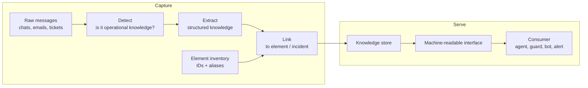

# Architecture options

> **Status: proposal.** This is a reference pipeline shared by every direction in [ideas.md](ideas.md), with alternatives at each stage. Nothing here is decided.

## Reference pipeline

The consumer changes with the idea: an agent (A), an action guard (B), a chat bot (C), an incident assistant (D), a proactive alert (E).

## Alternatives per stage

| Stage | Option 1 | Option 2 | Option 3 | Trade-off to discuss |
| --- | --- | --- | --- | --- |
| Detect | LLM zero-shot | Small fine-tuned classifier (e.g. on LLM-labelled data) | Keyword + embedding similarity | Accuracy vs. cost and latency |
| Extract | LLM with JSON-schema output | Open information extraction (triples) | Keep the snippet, tag it only (no extraction) | Structure vs. faithfulness to the source |
| Link | Exact ID / regex match | Alias table + fuzzy match | Embedding similarity over element descriptions | Usually chained: cheap first, precise last |
| Store | Property graph (Neo4j) | Relational DB + vector extension (Postgres + pgvector) | Document store + vector index | Graph queries vs. simplicity |
| Serve | REST API | Tool/function definition for an LLM agent (e.g. MCP server) | Event stream / webhook | Pull vs. push; who calls whom |
| Retrieve | Lookup by element ID | Vector search | GraphRAG (graph neighbourhood + LLM summary) | Precision vs. flexibility |

## Questions to settle once an idea is chosen

- Batch ingestion only, or real time (needed for C)?
- Does a human confirm facts, and when?
- How are freshness and contradictions scored?
- What exactly does the consumer receive: raw facts, a summary, or a decision?
