# Architecture and diagrams

> **Status: describes the code as it is on `main`.** Every diagram below is written in Mermaid (rendered by GitHub). For the schema rationale see [design.md](design.md); for the workbench API see [workbench.md](workbench.md).

## 1. The big picture: what we add to Elisa's network model

Elisa's layers describe what the network **is**, **was built as** and **does**. Nobody records what the humans **know about it**. That missing layer is what this project builds.

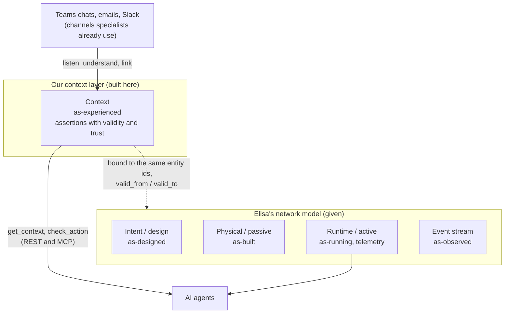

## 2. The pipeline: from a conversation to a reusable assertion

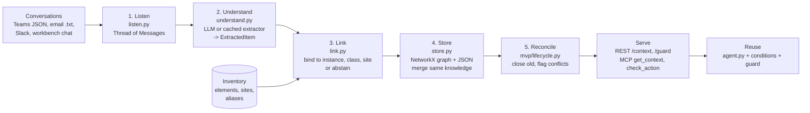

| Stage | Module | Decision it makes |
| --- | --- | --- |
| Listen | `listen.py` | Turns files (and live messages) into `Thread` / `Message` |
| Understand | `understand.py`, `llm.py` | Keeps the one sentence of real knowledge; returns nothing for chit-chat; never diagnoses |
| Link | `link.py` | Instance as evidence, class as scope; **abstains** when too broad, unknown or below `MIN_CONFIDENCE` |
| Store | `store.py` | Same binding and same author or same advice = one assertion with several sources; different advice = kept apart |
| Reconcile | `mvp/lifecycle.py` | An invalidation closes `valid_to`; two experts who disagree are both kept and flagged |
| Serve | `api.py`, `mcp_server.py` | `get_context(entity, at)` returns what is valid at time `t` for the node, its classes and its site |
| Reuse | `agent.py`, `mvp/conditions.py`, `mvp/guard.py` | Applies a rule only when its observed conditions do not contradict it; turns "reboot" into "bounce first" |

## 3. Data model

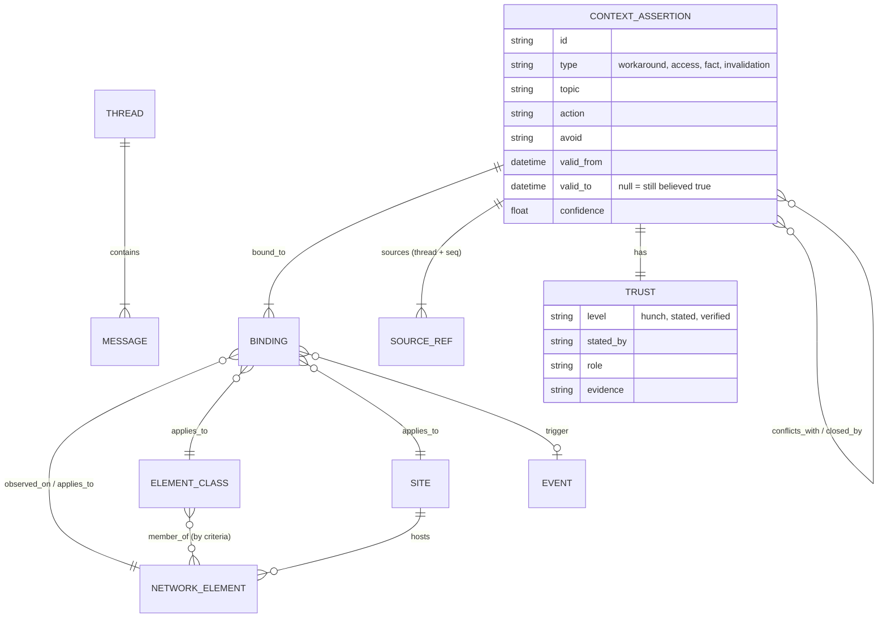

Binding roles: `applies_to` is the scope (class, site or instance when no class is given), `observed_on` is the instance that served as evidence, `trigger` is the event that starts the rule (for example `event:sfp-replacement`). The shared contract is `src/context_layer/models.py`.

## 4. Linking: right generality, never overlink

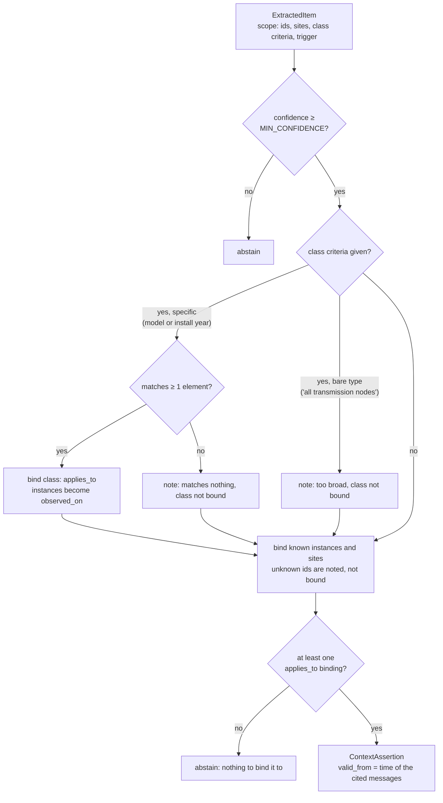

Example: "older units, TX-3000, up to 2019" becomes `class:transmission_node:tx-3000:installed-upto-2019` (scope), `TRN-042` (evidence) and `event:sfp-replacement` (trigger). A second TX-3000 installed in 2019 inherits the rule; one installed in 2023 does not.

## 5. Life of an assertion (lifecycle and trust)

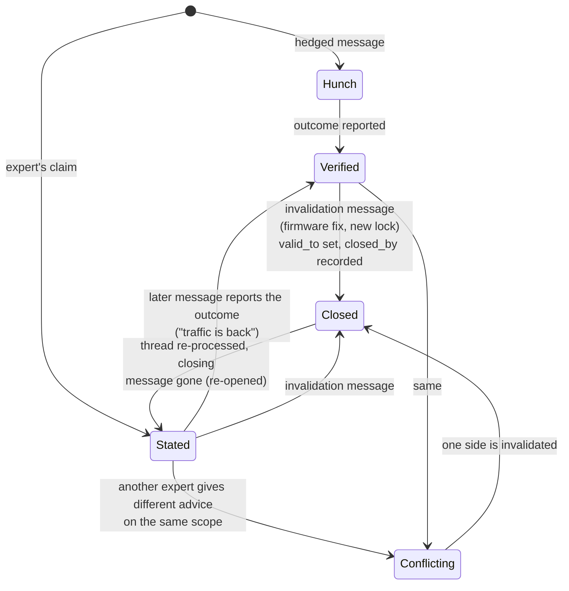

Rules, as implemented in `store.py` and `mvp/lifecycle.py`:

- Same binding and (same author or same action) merge into one assertion; the highest trust wins and the sources add up.
- A different action by a different author on the same scope is **not** merged: both stay, `conflicts_with` links them. Scope overlap is checked on class ids **and** instances, so "TX-3000" and "TX-3000 up to 2019" still conflict when both name TRN-088.
- An `invalidation` closes only knowledge that is **older** than itself, on the same topic and an overlapping scope. A replacement given in the same message stays open.
- Closed knowledge is no longer in conflict with anything and no longer returned by `get_context` (unless `include_expired`).
- Nobody is ever asked "is this still true?".

## 6. Reuse: what an agent does with it

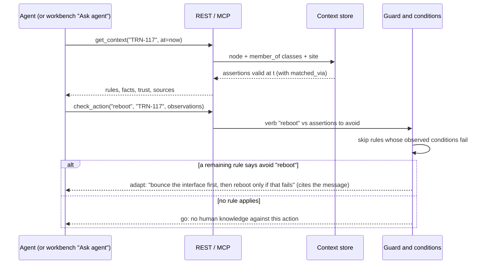

## 7. The Workbench

One Python process (FastAPI + one asyncio loop) serves the REST API, the SSE stream and the built React app.

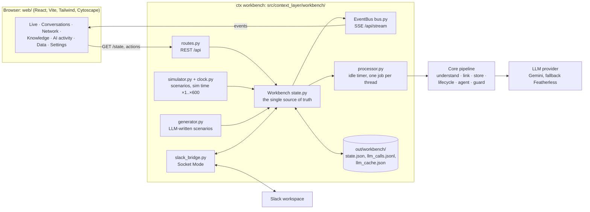

### What happens when a message is posted

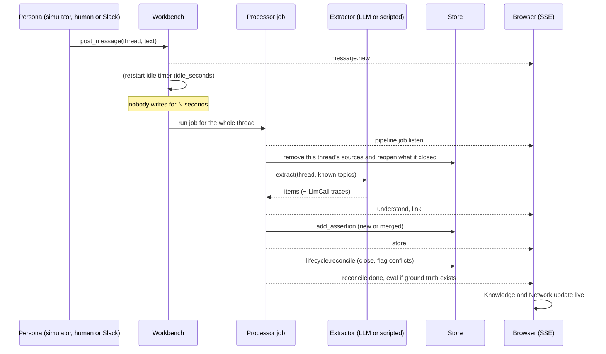

Re-processing a whole thread is idempotent, which is why a late message just triggers another job.

### Extractor choice and LLM fallback

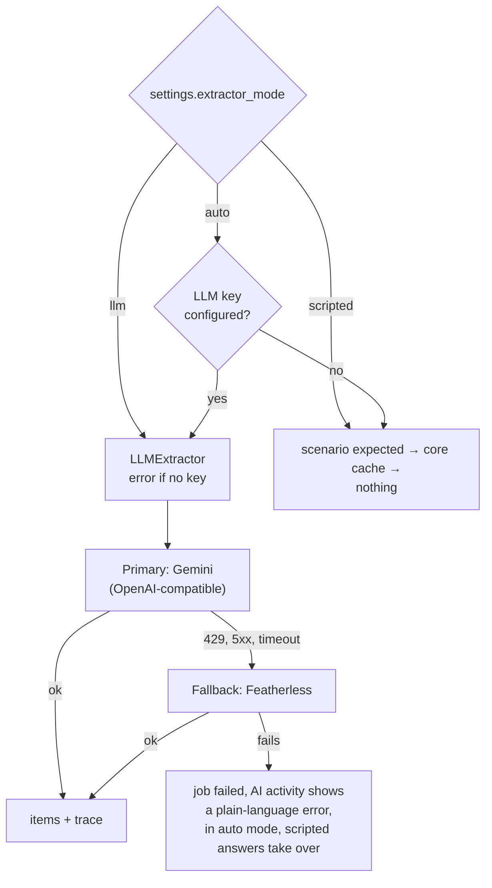

Every attempt, including the fallback one, is written to `llm_calls.jsonl` and shown on the **AI activity** page. API keys are never traced.

## 8. Deployment

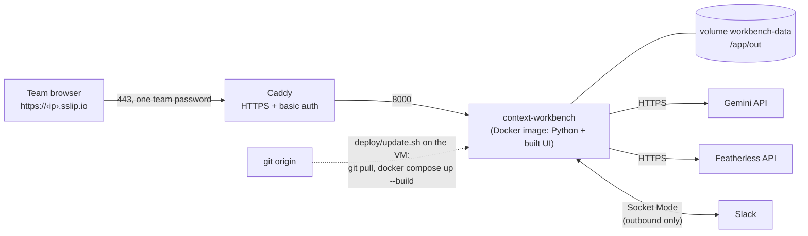

Slack uses Socket Mode, so the VM needs no public webhook. Details: [deploy-vultr.md](deploy-vultr.md), [slack-setup.md](slack-setup.md).

## 9. Code map

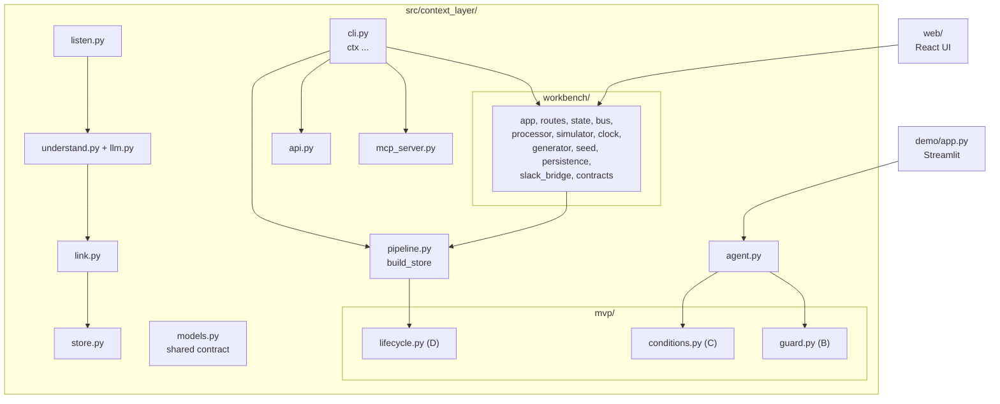
