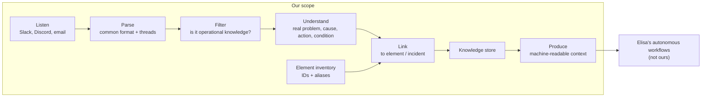

# Architecture options

> **Status: proposal.** This is a reference pipeline shared by every direction in [ideas.md](ideas.md), with alternatives at each stage. Nothing here is decided.

## Reference pipeline

Our job ends at the machine-readable context. Elisa's workflows consume it; we don't build them (see [challenge.md](challenge.md)).

## Alternatives per stage

| Stage | Option 1 | Option 2 | Option 3 | Trade-off to discuss |
| --- | --- | --- | --- | --- |
| Listen | Real connectors (Slack/Discord APIs, IMAP) | Exports replayed as a stream | Synthetic data only | Realism vs. demo safety |
| Parse | One common message schema + reply/thread IDs | + LLM thread reconstruction for email chains | | Thread quality drives extraction quality |
| Filter | LLM zero-shot | Small multilingual encoder (XLM-RoBERTa, mDeBERTa) fine-tuned on LLM-labelled data | Multilingual embeddings (multilingual-E5, BGE-M3) + simple classifier | Accuracy vs. compute (Elisa's bottleneck) |
| Understand | LLM with JSON-schema output (frontier API: Claude, GPT, Gemini) | Open-weight LLM (Qwen, Llama, Mistral; Poro/Viking for Finnish) | Keep the snippet, tag it only | Quality on implicit text vs. cost |
| Link | Exact ID / regex match | Alias table + fuzzy match, or zero-shot NER (GLiNER) | Embedding similarity over element descriptions | Usually chained: cheap first, precise last |
| Store | Property graph (Neo4j) | Relational DB + vector extension (Postgres + pgvector) | Document store + vector index | Graph queries vs. simplicity |
| Produce | JSON files / export with a versioned schema | REST API | Tool definition for an LLM agent (e.g. MCP server) | How "agent-ready" the output looks |

Suggested (not decided): a **cascade**. A cheap filter keeps a few percent of messages, and only those go to the LLM. It keeps compute low and the quality where it matters. Privacy is out of scope, so a frontier API is allowed; open-weight remains an option for cost or compute.

## Questions to settle once an idea is chosen

- Batch ingestion only, or a live stream?
- How are freshness and contradictions scored?
- What exactly does a workflow receive: atomic facts, a per-element profile, or both (see [data-model.md](data-model.md#making-the-context-exploitable))?

Settled by Elisa: no human confirms facts (no human input at all).
