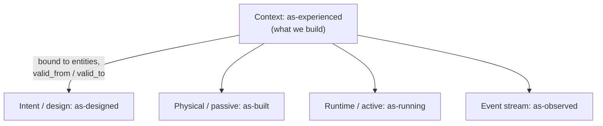
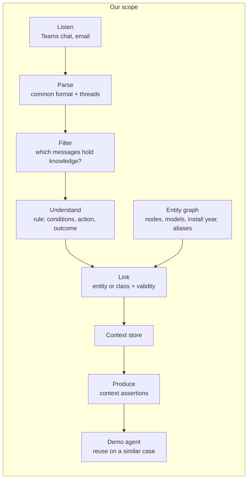

# Architecture options

> **Status: proposal.** This is a reference pipeline shared by every direction in [ideas.md](ideas.md), with alternatives at each stage. Nothing here is decided.

## Where we fit in Elisa's model

Elisa describes the network as time-aware layers (see [challenge.md](challenge.md#elisas-network-model)). We build the missing one: the **context layer (as-experienced)**, whose assertions are bound to entities of the other layers and carry `valid_from` / `valid_to`.

## Reference pipeline

Our job ends at the machine-readable context and a minimal agent that shows its reuse. Elisa's real workflows are not ours to build.

## Alternatives per stage

| Stage | Option 1 | Option 2 | Option 3 | Trade-off to discuss |
| --- | --- | --- | --- | --- |
| Listen | Files from Elisa's material + synthetic data | Replayed as a live stream (Teams-like) | Real connectors (Microsoft Graph for Teams/Outlook, IMAP) | Demo safety vs. "channels specialists already use" (Usability) |
| Parse | One common message schema + reply/thread IDs | + LLM thread reconstruction for email chains | | Thread quality drives extraction quality |
| Filter | LLM zero-shot | Small multilingual encoder (XLM-RoBERTa, mDeBERTa) fine-tuned on LLM-labelled data | Multilingual embeddings (multilingual-E5, BGE-M3) + simple classifier | Accuracy vs. cost; compute is not Elisa's constraint, so simplest is fine |
| Understand | LLM with JSON-schema output (frontier API: Claude, GPT, Gemini) | Open-weight LLM (Qwen, Llama, Mistral; Poro/Viking for Finnish) | Keep the snippet, tag it only | Quality on implicit text (😄, hedges) vs. cost |
| Link | Exact ID / regex match (TRN-042) | Alias table + attribute match (model, install year), or zero-shot NER (GLiNER) | Embedding similarity over entity descriptions | Precision first: a wrong link is worse than none |
| Store | Property graph (Neo4j) | Relational DB + vector extension (Postgres + pgvector) | Document store + vector index | Graph fits "bound to a graph entity"; relational is simpler |
| Produce | JSON export with a versioned schema | REST API | Tool definition for an LLM agent (e.g. MCP server) | How "agent-ready" it looks to judges |
| Reuse (demo) | Agent with a `get_context(entity)` tool | Retrieval by symptom similarity on a new case | GraphRAG (entity neighbourhood + LLM) | Elisa's "Reuse" step needs a similar case, not the same one |

Suggested (not decided): an LLM does filtering and understanding directly on the small material; a cheaper filter only if synthetic volume grows. Privacy and compute are not constraints, so a frontier API is allowed.

## Questions to settle once an idea is chosen

- Batch ingestion only, or a live stream?
- How do we decide the link's generality (instance vs. model vs. install-year class)?
- How do we set and close `valid_to`, and how is trust scored?
- What exactly does the agent receive: atomic assertions, a per-entity profile, or both (see [data-model.md](data-model.md#making-the-context-exploitable))?

Settled by Elisa: no human confirms facts (no extra work for specialists).
