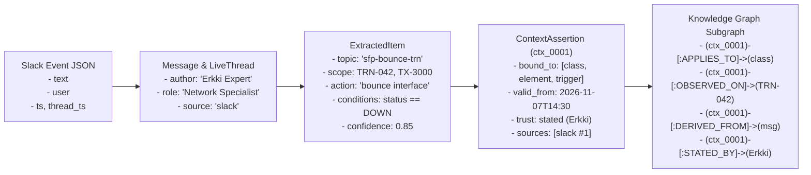
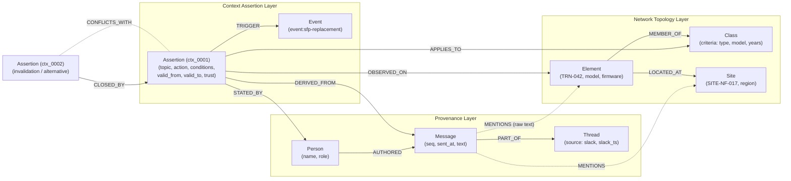
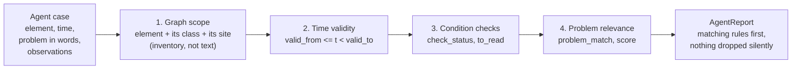

# Technical Pipeline: From Slack Message to Knowledge Node

This document details the complete end-to-end technical pipeline implemented on `main` that transforms unstructured human messages in Slack into structured, temporal, linked **Knowledge Nodes** within the operational Knowledge Graph.

---

## 1. End-to-End Architectural Pipeline

```mermaid
flowchart TD
    subgraph INGESTION["1. Ingestion & Event Handling"]
        SLACK["Slack Channel / Thread<br/>(Technician writes message)"]
        SOCKET["SlackBridge (Socket Mode)<br/>AsyncSocketModeHandler"]
        FILTER{"Filter Event<br/>- Ignore bots<br/>- Ignore self<br/>- Validate text"}
        RESOLVE["users.info API<br/>Extract real name & title"]
        THREAD_MAP{"Thread lookup<br/>thread_ts match?"}
        APPEND["Append to existing LiveThread"]
        NEW_TH["Create new LiveThread"]
    end

    subgraph SCHEDULER["2. Debounce & Job Scheduling"]
        POST["wb.post_message()"]
        DEBOUNCE["Idle Timer (2.0s debounce)<br/>Wait for human typing bursts"]
        LAUNCH["processor._launch()<br/>Acquire job lock"]
        JOB["Initialize PipelineJob<br/>[listen, understand, link, store, reconcile]"]
    end

    subgraph UNDERSTAND_STAGE["3. Understand Stage"]
        LISTEN["Stage Listen<br/>LiveThread.to_thread()"]
        PROMPT["Build Prompt<br/>Conversation + Known Topics"]
        LLM_EXTRACT["LLMExtractor<br/>Structured JSON Schema"]
        CRITIC_STEP_A{"Critic Step A<br/>Deterministic:<br/>evidence_quote in text?"}
        CRITIC_STEP_B{"Critic Step B<br/>LLM Critic Check:<br/>Scope, Vague Words, Support"}
        ITEMS["Validated ExtractedItem(s)"]
    end

    subgraph LINK_STAGE["4. Link Stage (Precision-First)"]
        INV[("Inventory<br/>Elements, Sites, Aliases")]
        CHECK_AUTHOR{"Author in thread?"}
        RESOLVE_ENTITIES{"Resolve Scope<br/>Named in thread & Inventory?"}
        CLASS_CRITERIA{"Class Criteria<br/>Specific & contains instances?"}
        BINDINGS["Assign Binding Roles:<br/>- applies_to<br/>- observed_on<br/>- trigger"]
        ASSERTION["Construct ContextAssertion<br/>(valid_from, trust, source_ref)"]
    end

    subgraph STORE_STAGE["5. Store & Deduplication"]
        RETRACT["retract(thread_id)<br/>Idempotency cleanup"]
        DEDUP{"same_knowledge()?<br/>Same binding + author/advice"}
        MERGE["Merge into existing assertion<br/>Combine sources & upgrade trust"]
        STORE_NEW["Add new assertion<br/>Assign ctx_XXXX ID"]
    end

    subgraph LIFECYCLE_STAGE["6. Multi-Agent Arbitration & Lifecycle"]
        JUDGE{"Judge Agent (LLM)<br/>Compare against neighbours"}
        JUDGE_ACTION["Apply Verdict:<br/>supersedes / contradicts / supports"]
        RECONCILE["lifecycle.reconcile()<br/>Reach coverage check<br/>Set valid_to / conflicts_with"]
    end

    subgraph GRAPH_STAGE["7. Knowledge Graph Projection"]
        KG[("KnowledgeGraph<br/>NetworkX / Neo4j Mirror")]
        NODE_ASSERTION["(Assertion: ctx_XXXX)"]
        NODE_MSG["(Message: msg:id#seq)"]
        NODE_PERSON["(Person: name)"]
        NODE_ENTITY["(Element | Class | Site | Event)"]
    end

    SLACK --> SOCKET
    SOCKET --> FILTER
    FILTER -- Valid human message --> RESOLVE
    RESOLVE --> THREAD_MAP
    THREAD_MAP -- Root ts exists --> APPEND
    THREAD_MAP -- New conversation --> NEW_TH
    APPEND --> POST
    NEW_TH --> POST

    POST --> DEBOUNCE
    DEBOUNCE --> LAUNCH
    LAUNCH --> JOB
    JOB --> LISTEN

    LISTEN --> PROMPT
    PROMPT --> LLM_EXTRACT
    LLM_EXTRACT --> CRITIC_STEP_A
    CRITIC_STEP_A -- Missing quote: penalty x0.7 --> CRITIC_STEP_B
    CRITIC_STEP_A -- Quote verified --> CRITIC_STEP_B
    CRITIC_STEP_B -- Reject --> DROPPED["Item Dropped"]
    CRITIC_STEP_B -- Downgrade / Keep --> ITEMS

    ITEMS --> CHECK_AUTHOR
    INV --> RESOLVE_ENTITIES
    CHECK_AUTHOR --> RESOLVE_ENTITIES
    RESOLVE_ENTITIES --> CLASS_CRITERIA
    CLASS_CRITERIA --> BINDINGS
    BINDINGS --> ASSERTION

    ASSERTION --> RETRACT
    RETRACT --> DEDUP
    DEDUP -- True --> MERGE
    DEDUP -- False --> STORE_NEW

    STORE_NEW --> JUDGE
    JUDGE --> JUDGE_ACTION
    JUDGE_ACTION --> RECONCILE
    MERGE --> RECONCILE

    RECONCILE --> KG
    KG --> NODE_ASSERTION
    KG --> NODE_MSG
    KG --> NODE_PERSON
    KG --> NODE_ENTITY
```



---

## 2. Detailed Execution Sequence

```mermaid
sequenceDiagram
    autonumber
    actor Tech as Network Engineer (Slack)
    participant Bridge as SlackBridge (Socket Mode)
    participant WB as Dashboard State
    participant Proc as Pipeline Processor
    participant LLM as LLMExtractor
    participant Critic as Critic Agent
    participant Linker as Linker & Inventory
    participant Store as ContextStore
    participant Judge as Judge Agent
    participant KG as KnowledgeGraph

    Tech->>Bridge: "On TRN-042 after SFP replacement, bounce interface if DOWN"
    Note over Bridge: Filter bot/system messages
    Bridge->>Bridge: Resolve user via slack.users.info (author, role)
    Bridge->>WB: post_message(thread_id, author, text, role)
    WB->>Proc: request(thread_id, immediate=False)
    Note over Proc: Debounce timer started (idle_seconds = 2.0s)
    
    rect rgb(240, 248, 255)
        Note over Proc: Idle timer expires; lock acquired
        Proc->>Proc: Create PipelineJob(thread_id)
        Proc->>LLM: extract(core_thread, known_topics)
        LLM-->>Proc: ExtractionResult([ExtractedItem])
    end

    rect rgb(255, 245, 238)
        Note over Proc,Critic: Hook: after_understand
        Proc->>Critic: Review item (Step A: quote check, Step B: LLM review)
        Critic-->>Proc: Verdict: keep / downgrade / reject
    end

    rect rgb(245, 255, 245)
        Note over Proc,Linker: Stage: Link
        Proc->>Linker: link(item, core_thread)
        Linker->>Linker: Verify author in thread
        Linker->>Linker: Resolve TRN-042 & match text mentions
        Linker->>Linker: Infer ElementClass & assign binding roles
        Linker-->>Proc: LinkResult(ContextAssertion)
    end

    rect rgb(255, 250, 240)
        Note over Proc,Store: Stage: Store
        Proc->>Store: retract(thread_id) [idempotent cleanup]
        Proc->>Store: add_assertion(assertion)
        Store->>Store: same_knowledge() check
        Store-->>Proc: (stored_assertion, is_new=True)
    end

    rect rgb(250, 240, 255)
        Note over Proc,Judge: Hook: after_store
        Proc->>Judge: Compare with stored candidate neighbours
        Judge-->>Proc: Verdicts: supersedes / contradicts / supports
        Proc->>Proc: lifecycle.reconcile() [reach-based invalidation]
    end

    rect rgb(240, 255, 255)
        Note over Proc,KG: Knowledge Graph Projection
        Proc->>KG: Project ContextStore + Messages into Graph
        KG->>KG: Create Node: Assertion(ctx_0001)
        KG->>KG: Create Node: Message(msg:slack_ts#1)
        KG->>KG: Create Node: Person(stated_by)
        KG->>KG: Add Edges: DERIVED_FROM, STATED_BY, APPLIES_TO, OBSERVED_ON
    end
```

---

## 3. Data Transformation Pipeline

The table below shows the exact data transformation contract from the raw Slack payload to the final Knowledge Graph entity:



---

## 4. Step-by-Step Technical Breakdown

### Step 1: Slack Ingestion & Normalization ([slack_bridge.py](file:///home/matteo/Projects/since-ai/src/context_layer/dashboard/slack_bridge.py#L154-L188))
- **Socket Mode Listener**: Connected via Slack App-Level Token (`xapp-...`) and Bot User Token (`xoxb-...`).
- **Event Filtering**: Discards bot events (`bot_id`, `IGNORED_SUBTYPES`: `bot_message`, `message_changed`, `message_deleted`, `channel_join`), self-messages, and empty payloads.
- **Identity Resolution**: Queries Slack API `users.info(user=user_id)` to resolve the real human name and job title (`profile.title`).
- **Thread Correlating**:
  - Checks if `thread_ts` links to an active conversation in `wb.thread_by_slack_ts(root_ts)`.
  - If found: Appends the message to the existing thread.
  - If new: Instantiates a `LiveThread` with `origin="slack"` and records the thread anchor.
- Calls `wb.post_message(thread_id, author=name, text=text, role=title, mirror=False)`.

### Step 2: Event Bus & Idle Debounce ([processor.py](file:///home/matteo/Projects/since-ai/src/context_layer/dashboard/processor.py#L167-L198))
- Network specialists rarely send operational knowledge in a single sentence; they write multi-line explanations or follow-ups.
- `processor.request(thread_id, immediate=False)` schedules a debounce timer (`wb.settings.idle_seconds`, default `2.0s`).
- Successive messages in the same thread reset the timer.
- When quiet, `processor._launch(thread_id)` triggers a worker task on the `asyncio` event loop.
- Uses an `asyncio.Lock` to guarantee that concurrent threads don't race on store mutations.

### Step 3: Understanding via LLM Extraction ([understand.py](file:///home/matteo/Projects/since-ai/src/context_layer/understand.py#L61-L97))
- Assembles full thread context into `models.Thread`.
- Passes the list of currently known topic slugs (`known_topics`) to promote deduplication and topic reuse across channels.
- Invokes `LLMExtractor`:
  - Strict system prompt requiring Pydantic JSON Schema validation (`ExtractionResult`).
  - Instructs the model: *extract only operational rules or facts*, *never diagnose faults yourself*, *copy entity IDs verbatim*, *flag vague scope words* (`qualifier: "old"`).
  - Produces structured `ExtractedItem` objects.

### Step 4: Critic Verification Hook ([critic.py](file:///home/matteo/Projects/since-ai/src/context_layer/critic.py#L29-L90))
- Runs on the `after_understand` hook before any entities are linked:
  1. **Deterministic Evidence Check**: Validates that `item.evidence_quote` matches verbatim text in the cited message sequence. If fabricated or hallucinated, applies a penalty: `confidence = confidence * 0.7`.
  2. **LLM Critic Review**: A secondary LLM prompt reviews each item for:
     - **Scope inflation**: Did the author mention a specific unit while the extractor bound an entire class or site?
     - **Vague word leakage**: Was a word like "legacy" converted into an unsubstantiated install-year filter?
     - **Truthfulness**: Does the cited text genuinely back the action?
  - Verdicts: `keep`, `downgrade` (sets lower `confidence_after`), or `reject` (discards item).

### Step 5: Precision Linking ([link.py](file:///home/matteo/Projects/since-ai/src/context_layer/link.py#L200-L291))
- Adheres to the principle: **A wrong link is worse than none (abstain rather than guess)**.
- **Author Verification**: Verifies `stated_by` corresponds to a verified speaker in the thread.
- **Entity Resolution**:
  - Matches element IDs against `Inventory` (including aliases like `TRN42` -> `TRN-042`).
  - Regex check (`mention_pattern`) confirms the entity was literally mentioned in the text.
- **ElementClass Scope Validation**:
  - Resolves `ClassCriteria(type, model, install_year_min, install_year_max)`.
  - Rejects classes that are too broad (e.g., "all elements") or that exclude the unit the thread is specifically discussing.
  - If a vague qualifier word was present (`qualifier="old"`), multiplies confidence by `0.8` with an explicit audit note (`"class wider than stated"`).
- **Role Binding**:
  - `applies_to`: Target of the advice (the `ElementClass`, specific `NetworkElement`, or `Site` if local).
  - `observed_on`: Specific element instance where the issue was observed.
  - `trigger`: Event slug (e.g. `event:sfp-replacement`).

### Step 6: Store Deduplication & Idempotence ([store.py](file:///home/matteo/Projects/since-ai/src/context_layer/store.py#L73-L135))
- **Retraction**: `processor.retract(thread_id)` drops earlier assertions derived solely from this thread, ensuring re-processing is completely idempotent.
- **Deduplication Check (`same_knowledge`)**:
  - Compares `(type, topic, bound_to)` and checks if author or advice matches.
  - **If match exists**: Merges sources, sets `valid_from = min(...)`, `confidence = max(...)`, and calls `trust.add_confirmation(...)`.
  - **If new assertion**: Generates ID (`ctx_0001`), saves in store index, and creates graph edges.

### Step 7: Judge Arbitration & Reconcile ([judge.py](file:///home/matteo/Projects/since-ai/src/context_layer/judge.py#L30-L75), [lifecycle.py](file:///home/matteo/Projects/since-ai/src/context_layer/mvp/lifecycle.py#L27-L72))
- **LLM Judge**: Compares new assertion against up to 8 candidate assertions retrieved by topology bindings:
  - `supersedes`: Closes older candidate (`valid_to = new.valid_from`, `closed_by = new.id`).
  - `contradicts`: Flags bidirectional conflict in `conflicts_with`.
  - `supports`: Adds source and upgrades trust rank.
- **Reach Invalidation**: If the assertion is of type `invalidation` (e.g. firmware upgrade), checks `store.reach(invalidation)`. If it completely subsumes older rules, marks them closed.

### Step 8: Multi-Layer Knowledge Graph Projection ([kg.py](file:///home/matteo/Projects/since-ai/src/context_layer/graph/kg.py#L40-L132))
- Context assertions, network topology, and raw Slack communication are projected into an interconnected graph:
  - **Provenance Layer**: Slack message node linked to author `(Person)-[:AUTHORED]->(Message)-[:PART_OF]->(Thread)`.
  - **Extraction Layer**: `(Assertion)-[:DERIVED_FROM]->(Message)` and `(Assertion)-[:STATED_BY]->(Person)`.
  - **Episodic Mentions**: `(Message)-[:MENTIONS]->(Element)`.
  - **Operational Layer**: `(Assertion)-[:APPLIES_TO]->(Class)` and `(Assertion)-[:OBSERVED_ON]->(Element)`.
  - **Topology Layer**: `(Element)-[:MEMBER_OF]->(Class)` and `(Element)-[:LOCATED_AT]->(Site)`.
  - **Lifecycle Layer**: `(Assertion)-[:CLOSED_BY]->(Assertion)` and `(Assertion)-[:CONFLICTS_WITH]->(Assertion)`.

---

## 5. Knowledge Graph Multi-Layer Ontology



---

## 6. Retrieval: From Knowledge Node Back to the Agent

Capturing knowledge is half the job; the other half is handing an agent **the right knowledge, valid now, about its problem, and nothing else**. At company scale this is the hard part: in our synthetic operator (3,000,000 threads, 13.8 M messages, 20,086 elements, 3,000 ground-truth facts) a TX-3000 node is covered by a median of **316 valid facts**, 21 of them about the same problem. Returning "everything known about the element" is correct but useless.

> Code: `src/context_layer/mvp/relevance.py` (problem relevance), `src/context_layer/eval/scale.py` (`ctx dataset eval`). Full method and raw report: [evaluation.md, Part 3](../evaluation.md#part-3-retrieval-accuracy-at-company-scale) and [results/scale-large](../results/scale-large/README.md).



### The approaches, and what each one fixes

| # | Approach | How | Where | Measured effect |
| --- | --- | --- | --- | --- |
| 1 | **Graph first, text second** | Retrieve through the element, its `ElementClass` and its site, resolved from the inventory, not by text similarity | `store.get_context` | 0 wrong-element answers (RAG over the same knowledge without the graph: 41,345) |
| 2 | **Time is a filter** | Each assertion has `valid_from` / `valid_to`; invalidations (firmware fix, key moved) close it | `store.py`, `mvp/lifecycle.py` | 0 stale answers; 46 / 46 site-access changes closed at the right time |
| 3 | **Condition checks with a check status** | Rules are tested on the agent's observations. Each kept rule says `fully checked`, `not fully checked` (with `to_read` fields) or `text only`; failed rules are listed as "not applied" | `agent.run_agent(use_conditions=True)` | 26 hand-written cases: 73% → 100%; the right answer is never lost when observations are missing |
| 4 | **Problem relevance** (second stage) | IDF-weighted share of the problem's concepts that a rule mentions; small field thesaurus (SFP = transceiver = optic, reboot = restart, flap…); scope words (ids, site names, years) removed because the graph handles them; an invalidation inherits the problem of the rules it closed. Threshold 0.4, chosen on a separate tuning wording | `mvp/relevance.py`, `run_agent(use_relevance=True)`, MCP/REST `?problem=` | Precision 10.8% → 73.0%; rules handed to the agent p95 42 → 6 |
| 5 | **One rule per piece of knowledge** | Same knowledge is compared on scope (`applies_to`, trigger), not on where it was seen; a release closes only bug reports about *older* firmware | `store.py` `_binding_key`, `lifecycle.py` `fix_predates` | Hunch later confirmed kept as one verified rule: 72 → 285 of 285; wrong closures 41 → 0 |

### Results against simpler approaches (9,300 agent cases, test wording)

| Pipeline | Accuracy | Solution found | Precision | Rules per case p50 / p95 | Stale | Wrong element |
| --- | --- | --- | --- | --- | --- | --- |
| Naive RAG over raw chats (BM25, top 5)* | 0.3% | 66.6% | 11.1% | 5 / 5 | 119 | 6,548 |
| RAG over extracted knowledge, no graph (top 5) | 1.7% | 49.6% | 8.1% | 5 / 5 | 0 | 41,345 |
| Graph scope + time + condition checks | 48.3% | 100% | 10.8% | 2 / 42 | 0 | 0 |
| + problem relevance, default (all rules when none matches) | **80.3%** | 100% | 44.8% | 1 / 10 | 0 | 0 |
| + problem relevance, strict | **89.0%** | 100% | 73.0% | 1 / 6 | 0 | 0 |

\* 2,000-case sample over all knowledge threads plus 300,000 other threads; on that sample the other rows move by less than one point. **Accuracy** = the right knowledge came back (or nothing, when nothing applies) and no noise. Latency: p50 under 0.5 ms, p95 about 12 ms for the graph pipelines.

By kind of case, the ones that matter most for the challenge:

| Kind of case | Graph + time + conditions | + relevance, default | + relevance, strict |
| --- | --- | --- | --- |
| Similar case, same class (the brief's demo step 3) | 0.0% | 84.8% | 84.8% |
| Near miss: same model, outside the class | 7.6% | 68.6% | 90.6% |
| After the knowledge was closed | 11.9% | 80.1% | 80.1% |
| Dispatch to the site (access knowledge) | 69.6% | 100% | 100% |

**Linking**: 3,000 of 3,000 facts linked, reach exact 100%, 0 over-linked (1,295 class, 1,116 instance, 589 site facts), from the real thread text.

**With the real LLM extractor** (26 hand-written chats, recorded run): problem relevance lifts accuracy from 65.4% to 80.8% and cuts noise items from 13 to 5.

### What we tried and rejected

- **Ranking by weights** (trust, specificity, LLM confidence): fixed priorities are biased (on TRN-305 after a power dip, "verified" and "unit-specific" both put the wrong rule first), and LLM confidence is not calibrated: it ranked worst.
- **Dropping every rule that could not be fully checked**: lost the right answer in 31–48% of runs. Showing noise with a check status is better than losing the answer.

### How to read these numbers

- Synthetic data with templated chat language, and the ground truth as extractor (an oracle), so absolute values are an upper bound; the **gaps between pipelines** are the finding. Nothing here is Elisa data.
- Incident wordings were written by hand before the matcher, in two wordings: `dev` to tune the thesaurus and threshold, `test` to report.
- The dashboard, MCP and REST use the default variant; strict is measured, not wired.
- Re-run: `uv run ctx dataset generate --scale large`, then `uv run ctx dataset eval out/dataset/large --split test`.