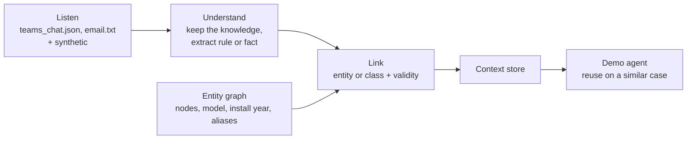
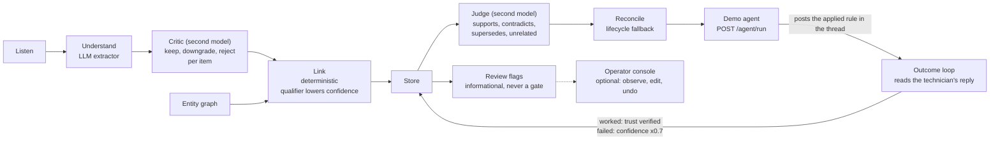

# Design options

> **Status: proposal for the original sections; the loop v2 additions are marked *implemented* (on branch `worktree-loop-v2`, see [plan-loop-v2.md](plan-loop-v2.md) and [decisions.md](decisions.md)).** A pipeline and a schema to react to. Freeze them only once an idea is chosen; then every workstream codes against them.

## Pipeline

We build Elisa's missing **context layer** (see [challenge.md](challenge.md#elisas-network-model)). Our job ends at machine-readable assertions and a minimal agent that reuses them.



| Stage | Simple option | Alternatives | Trade-off |
| --- | --- | --- | --- |
| Listen | Load files from `data/` | Replay them as a live stream; real connectors (Microsoft Graph) | Demo safety vs. "channels specialists already use" |
| Understand | One LLM call with JSON-schema output per thread | Separate filter + extractor; zero-shot NER (GLiNER) for entities | The material is tiny, so one good call is enough |
| Link | Exact ID match (`TRN-042`) + attributes (model, install year) to pick a class | Alias table; embedding similarity | **Precision first: abstain rather than guess** |
| Store | Graph (Neo4j, or NetworkX in memory) | Postgres / SQLite + JSON | Elisa recommends graphs; in-memory is quickest |
| Serve | `get_context(entity, at_time)` as an MCP tool | REST (FastAPI); JSON export | MCP reads as "agent-ready" |
| Reuse | LLM agent with that tool on a new synthetic case | Rule evaluator (idea C) | Must be a **similar** case on **another** node |

No human confirms anything (Elisa: no extra work for specialists).

### Loop v2: three targeted agents (implemented)

The five stages above are unchanged. Three agents are added at the places where text is ambiguous, each behind a `Settings` toggle (`use_critic`, `use_judge`, `use_outcome_loop`, default off) and each unable to block a job: on any failure the job notes it and goes on. Linking stays deterministic. The loop is fully automated; nothing waits for a human. The operator console only observes and can override.



| Agent | Where it runs (hook) | What it does | Status |
| --- | --- | --- | --- |
| Critic (`critic.py`) | `after_understand`, only when the extractor is an LLM | A deterministic check that the verbatim `evidence_quote` appears in a cited message (not found: confidence x0.7), then one LLM call per thread (role `critic`, a different provider when `LLM_CRITIC_*` is set) that returns keep, downgrade or reject per item. Rejected items are dropped, downgraded ones get a lower confidence | Implemented, never tested against a real model |
| Linker qualifier (`link.py`) | inside Link | A vague scope word kept in `Scope.qualifier` that ended up as a class adds the note "class wider than stated" and multiplies the confidence by 0.8. Instance-only scope is unchanged | Implemented |
| Judge (`judge.py`) | `after_store`, then `lifecycle.reconcile` still runs | One LLM call per new assertion (role `critic`, purpose `judge`) against up to 8 neighbours found by bindings, never by topic slug. Applies the verdicts deterministically: close an older rule (supersedes, only when safe), keep both and flag (contradicts), merge into the older one or add a source and upgrade trust (supports) | Implemented, never tested against a real model |
| Outcome loop (`outcome.py`) | `after_understand` (drops items citing the agent's own message), `after_store` | The agent's applied action is posted in a thread as one informative message; one `RuleApplication` per applied assertion. The technician's next messages decide worked, failed or unclear (LLM, else a keyword heuristic). Worked: trust becomes `verified` and the thread is added as a source. Failed: confidence x0.7 | Implemented |

Review flags (`workbench/review.py`) are produced after a job: abstained, low confidence (below 0.7), conflict, over-reach (a rule reaching at least 6 elements the thread never names), critic and judge decisions. They are informational: the knowledge is already live.

## Entities

| Entity | Key fields | Example |
| --- | --- | --- |
| `NetworkElement` | `id`, `type`, `model`, `install_year`, `site_id`, `aliases[]` | `TRN-042`, transmission node, ~2019 |
| `ElementClass` | `id`, `criteria` (type, model, install year range) | "older transmission units, ~2019" |
| `Site` | `id`, `name`, `access` | the Northern Finland site behind a barrier |
| `Message` | `id`, `source` (teams, email), `thread_id`, `author`, `role`, `sent_at`, `text` | Erkki, Network Expert, `seq` 8 |
| `ContextAssertion` | see below | |

`ElementClass` answers Elisa's linking question: binding the rule to a class lets it reach **another** old node, which the Reuse step needs. Only `TRN-042` comes from Elisa; other elements, models and sites are ours to generate.

## Context assertion

Two shapes: a **rule** when there are conditions (Erkki), a **fact** otherwise (barrier key).

```json
{
  "id": "ctx_0001",
  "type": "workaround",
  "bound_to": [
    {"entity": "class:transmission-node-2019", "role": "applies_to"},
    {"entity": "TRN-042", "role": "observed_on"},
    {"entity": "event:sfp-replacement", "role": "trigger"}
  ],
  "conditions": ["after SFP replacement", "interface UP", "optical levels normal", "traffic counters at zero"],
  "diagnosis": "forwarding-state issue, not a faulty SFP",
  "action": "disable the interface, wait, enable it",
  "avoid": ["replace SFP again", "reboot the unit (unless the bounce fails)"],
  "valid_from": "<date of the chat>T09:22:00",
  "valid_to": null,
  "trust": {"level": "verified", "evidence": "teams seq 9: 'Traffic is back'", "stated_by": "Erkki Expert", "role": "Network Expert"},
  "sources": [
    {"source": "teams", "file": "teams_chat.json", "seq": [2, 4, 6, 8, 10]},
    {"source": "email", "file": "email.txt"}
  ],
  "conflicts_with": [],
  "confidence": 0.85
}
```

`teams_chat.json` has times but **no date**: pick one for the demo and say so in the docs.

```json
{
  "id": "ctx_0002",
  "type": "access",
  "bound_to": [{"entity": "SITE-NF-017", "role": "applies_to"}],
  "fact": "The private road is closed by a locked barrier; key held at <location>",
  "action": "get the key before dispatch",
  "valid_from": "<email date>",
  "valid_to": null,
  "trust": {"level": "stated", "stated_by": "<sender>"},
  "sources": [{"source": "email", "file": "<synthetic email>"}]
}
```

Elisa gives no email or key location for the barrier: this one is synthetic data to generate.

### Fields added by loop v2 (implemented, as they exist in code)

Shared contract: `src/context_layer/models.py`; workbench-only types in `src/context_layer/workbench/contracts.py`.

| Field | Where | Meaning |
| --- | --- | --- |
| `scope.qualifier` | `Scope` (extracted item) | The vague word the speakers used ("old", "legacy") copied as written, never turned into a year range. Not stored on the assertion; the linker turns it into the note "class wider than stated" and a x0.8 confidence |
| `evidence_quote` | `ExtractedItem` | One short verbatim quote from a cited message that supports the item. The critic checks it appears in the cited messages |
| source kind `operator` | `SourceKind` (`teams`, `email`, `slack`, `operator`) | Added to an assertion's `sources` when an operator edits it in the console; `stated_by` becomes `operator` only when the trust level is edited. An edit survives re-processing and can be undone |
| `RuleApplication` | workbench contract | `id`, `assertion_id`, `entity_id`, `thread_id`, `applied_at`, `message_seq`, `outcome` (pending, worked, failed, unclear), `outcome_quote`, `outcome_reason`, `outcome_at`, `method` (llm or heuristic). One per assertion the agent applied |

Also in the workbench contract: `ReviewFlag`, `CriticVerdict` and `JudgeVerdict` (stored on the pipeline job), and `AssertionEdit` (before and after of each operator change).

### Fields and Elisa's hard points

| Field | Hard point | Rule |
| --- | --- | --- |
| `bound_to[]` with roles | Linking | Instance as evidence, class as scope; never bind when unsure |
| `valid_from` / `valid_to` | Time | `null` = still believed true; closed by a later contradicting message |
| `trust` + `stated_by` + role | Trust | `hunch` / `stated` / `verified`; an observed outcome upgrades it (implemented: the passive outcome loop and the judge's `supports` verdict) |
| `conflicts_with[]` | Trust | Two experts disagree: keep both, flag it |
| `sources[]` | Traceability | Chat and email of the same case = one assertion, two sources |
| `conditions`, `action`, `avoid` | Agent-ready | An agent can act without reading free text |

## Open points

- Atomic assertions only, or also a per-entity profile built on request?
- How to choose the class ("older units" → install year? model?) when the text is vague? Loop v2 keeps the vague word as a qualifier and lowers the confidence instead of guessing; whether that is enough is open.
- Does a contradiction close the old assertion, or keep both with a conflict flag? Loop v2: a `supersedes` verdict closes the older rule only when it is safe (same or higher trust, or an invalidation); otherwise both stay open and are flagged.
