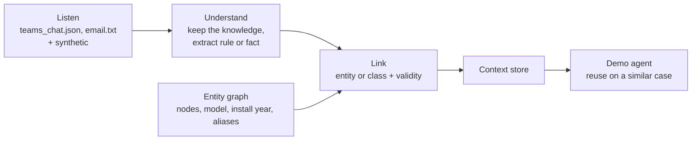

# Design options

> **Status: proposal.** A pipeline and a schema to react to. Freeze them only once an idea is chosen; then every workstream codes against them.

## Pipeline

We build Elisa's missing **context layer** (see [challenge.md](challenge.md#elisas-network-model)). Our job ends at machine-readable assertions and a minimal agent that reuses them.



| Stage | Simple option | Alternatives | Trade-off |
| --- | --- | --- | --- |
| Listen | Load files from `data/` | Replay them as a live stream; real connectors (Microsoft Graph) | Demo safety vs. "channels specialists already use" |
| Understand | One LLM call with JSON-schema output per thread | Separate filter + extractor; zero-shot NER (GLiNER) for entities | The material is tiny, so one good call is enough |
| Link | Exact ID match (`TRN-042`) + attributes (model, install year) to pick a class | Alias table; embedding similarity | **Precision first: abstain rather than guess** |
| Store | Graph (Neo4j, or NetworkX in memory) | Postgres / SQLite + JSON | Elisa recommends graphs; in-memory is quickest |
| Serve | `get_context(entity, at_time)` as an MCP tool | REST (FastAPI); JSON export | MCP reads as "agent-ready" |
| Reuse | LLM agent with that tool on a new synthetic case | Rule evaluator (idea C) | Must be a **similar** case on **another** node |

No human confirms anything (Elisa: no extra work for specialists).

## Entities

| Entity | Key fields | Example |
| --- | --- | --- |
| `NetworkElement` | `id`, `type`, `model`, `install_year`, `site_id`, `aliases[]` | `TRN-042`, transmission node, ~2019 |
| `ElementClass` | `id`, `criteria` (type, model, install year range) | "older transmission units, ~2019" |
| `Site` | `id`, `name`, `access` | the Northern Finland site behind a barrier |
| `Message` | `id`, `source` (teams, email), `thread_id`, `author`, `role`, `sent_at`, `text` | Erkki, Network Expert, `seq` 8 |
| `ContextAssertion` | see below | |

`ElementClass` answers Elisa's linking question: binding the rule to a class lets it reach **another** old node, which the Reuse step needs. Only `TRN-042` comes from Elisa; other elements, models and sites are ours to generate.

## Context assertion

Two shapes: a **rule** when there are conditions (Erkki), a **fact** otherwise (barrier key).

```json
{
  "id": "ctx_0001",
  "type": "workaround",
  "bound_to": [
    {"entity": "class:transmission-node-2019", "role": "applies_to"},
    {"entity": "TRN-042", "role": "observed_on"},
    {"entity": "event:sfp-replacement", "role": "trigger"}
  ],
  "conditions": ["after SFP replacement", "interface UP", "optical levels normal", "traffic counters at zero"],
  "diagnosis": "forwarding-state issue, not a faulty SFP",
  "action": "disable the interface, wait, enable it",
  "avoid": ["replace SFP again", "reboot the unit (unless the bounce fails)"],
  "valid_from": "<date of the chat>T09:22:00",
  "valid_to": null,
  "trust": {"level": "verified", "evidence": "teams seq 9: 'Traffic is back'", "stated_by": "Erkki Expert", "role": "Network Expert"},
  "sources": [
    {"source": "teams", "file": "teams_chat.json", "seq": [2, 4, 6, 8, 10]},
    {"source": "email", "file": "email.txt"}
  ],
  "conflicts_with": [],
  "confidence": 0.85
}
```

`teams_chat.json` has times but **no date**: pick one for the demo and say so in the docs.

```json
{
  "id": "ctx_0002",
  "type": "access",
  "bound_to": [{"entity": "SITE-NF-017", "role": "applies_to"}],
  "fact": "The private road is closed by a locked barrier; key held at <location>",
  "action": "get the key before dispatch",
  "valid_from": "<email date>",
  "valid_to": null,
  "trust": {"level": "stated", "stated_by": "<sender>"},
  "sources": [{"source": "email", "file": "<synthetic email>"}]
}
```

Elisa gives no email or key location for the barrier: this one is synthetic data to generate.

### Fields and Elisa's hard points

| Field | Hard point | Rule |
| --- | --- | --- |
| `bound_to[]` with roles | Linking | Instance as evidence, class as scope; never bind when unsure |
| `valid_from` / `valid_to` | Time | `null` = still believed true; closed by a later contradicting message |
| `trust` + `stated_by` + role | Trust | `hunch` / `stated` / `verified`; an observed outcome upgrades it |
| `conflicts_with[]` | Trust | Two experts disagree: keep both, flag it |
| `sources[]` | Traceability | Chat and email of the same case = one assertion, two sources |
| `conditions`, `action`, `avoid` | Agent-ready | An agent can act without reading free text |

## Open points

- Atomic assertions only, or also a per-entity profile built on request?
- How to choose the class ("older units" → install year? model?) when the text is vague?
- Does a contradiction close the old assertion, or keep both with a conflict flag?
