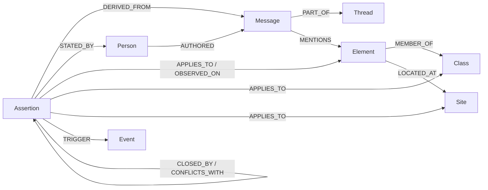

# Knowledge graph

> **Status: proposal** (branch `feat/knowledge-graph`, built on `feat/workbench`). Not logged in [decisions.md](decisions.md) yet.

`context_layer.graph` turns the context store into **one typed, temporal knowledge graph**: the network, the context assertions, their lifecycle and their provenance (who said it, where, when). Agents query it through MCP, REST or the CLI. Neo4j is an optional mirror.

The graph is a **view rebuilt from the store and the threads**. `ContextStore` stays the source of truth, so the pipeline, guard, agent and workbench work unchanged.

## Inspired by Beever Atlas

[Beever Atlas](https://github.com/Beever-AI/beever-atlas) builds a knowledge graph from team chats (Slack, Teams…) and serves it to agents over MCP. We took what fits Elisa's brief and left the rest.

| Beever Atlas | Here | Why |
| --- | --- | --- |
| Entities and relationships in a graph (Neo4j) | Typed nodes and edges (below), NetworkX in memory, optional Neo4j mirror | Elisa recommends graph DBs; in memory keeps the demo zero-setup |
| Relationships with `confidence`, `valid_from` / `valid_until`, a source quote | Assertions carry `valid_from` / `valid_to`, trust and `confidence`; `snapshot(at)` gives the graph as believed at `t` | Elisa's time-aware layers |
| Episodic links: entity ↔ the message it came from | `DERIVED_FROM` (assertion → message) and `MENTIONS` (message → element, from the raw text) | Traceability; finds messages about a node even when nothing was extracted |
| Entity registry with aliases, normalized-name dedup | Reuses the core `Inventory` aliases (`TRN42` → `TRN-042`) | Already in the core; precision first |
| Graph tools for agents (`find_experts`, `trace_decision_history`) over MCP | `find_experts`, `get_timeline`, `get_provenance`, `get_rule_reach` | Same idea, network-ops questions |
| Embedding and LLM entity merging, Weaviate, wiki, 16 ADK agents | Not taken | A wrong link is worse than none; too much for 48h |

## Ontology



| Node | Id | Key properties |
| --- | --- | --- |
| `Element` | `TRN-042` | `type`, `model`, `install_year`, `firmware`, `aliases` |
| `Site` | `SITE-NF-017` | `name`, `region` |
| `Class` | `class:transmission_node:installed-upto-2019` | criteria (`type`, `model`, install year range) |
| `Event` | `event:sfp-replacement` | — |
| `Assertion` | `ctx_0002` | `type`, `topic`, `summary`, `action`, `avoid`, `conditions`, `valid_from`, `valid_to`, `trust_level`, `confidence`, `payload` (the full assertion as JSON) |
| `Person` | `person:erkki-expert` | `name`, `role` |
| `Message` | `msg:elisa/teams_chat.json#8` | `source`, `seq`, `author`, `sent_at`, `text` |
| `Thread` | `thread:elisa/teams_chat.json` | `source`, `subject`, `started_at` |

The ontology is in [`src/context_layer/graph/schema.py`](../src/context_layer/graph/schema.py).

## Queries

| Question | Python (`KnowledgeGraph`) | MCP tool | REST | CLI |
| --- | --- | --- | --- | --- |
| Where does this knowledge come from? | `provenance(aid)` | `get_provenance` | `/graph/provenance/{aid}` | `ctx graph provenance ctx_0002` |
| Which elements does a rule reach? (overlinking check) | `reach(aid)` | `get_rule_reach` | `/graph/reach/{aid}` | `ctx graph reach ctx_0002` |
| Who knows about this node? | `experts(entity, at)` | `find_experts` | `/graph/experts?entity_id=` | `ctx graph experts TRN-117` |
| How did the advice change over time? | `timeline(entity, at)` | `get_timeline` | `/graph/timeline/{id}` | `ctx graph timeline TRN-117 --at 2026-11-05T10:00` |
| Which raw messages name this node? | `mentions(entity)` | — | `/graph/mentions/{id}` | `ctx graph mentions TRN-042` |
| Graph around a node / at time `t` | `neighborhood(id, depth)`, `snapshot(at)` | — | `/graph?node=&depth=&at=` (Cytoscape elements) | `ctx graph export --format cytoscape --at …` |

`get_context` and `check_action` (core) are unchanged.

On the current data (`ctx run --lifecycle`): Erkki's rule reaches **TRN-042 and TRN-117 only** (not TRN-208 from 2020, not TRN-305 from 2024). It is cited to chat `seq` 2, 4, 6, 8, 10 and the email. The firmware message closes it on 2026-10-30. Erkki comes first as expert for TRN-117.

## Neo4j (optional)

```bash
uv sync --extra neo4j
# set NEO4J_PASSWORD in .env (at least 8 characters)
docker compose --env-file .env -f deploy/docker-compose.neo4j.yml up -d
uv run ctx graph push            # MERGE, idempotent; --wipe to start clean
# or, without the driver: uv run ctx graph export --format cypher --out out/graph.cypher
```

Browser at http://localhost:7474. Example queries:

```cypher
// What applies to TRN-117 on 2026-10-20, directly or through its class or site?
MATCH (e:Element {id: "TRN-117"})-[:MEMBER_OF|LOCATED_AT*0..1]->(scope)<-[:APPLIES_TO|OBSERVED_ON]-(a:Assertion)
WHERE a.valid_from <= localdatetime("2026-10-20T08:00")
  AND (a.valid_to IS NULL OR localdatetime("2026-10-20T08:00") < a.valid_to)
RETURN a.id, a.action, a.trust_level;

// Provenance of a rule
MATCH (a:Assertion {id: "ctx_0002"})-[:DERIVED_FROM]->(m:Message)<-[:AUTHORED]-(p:Person)
RETURN p.name, m.source, m.seq, m.text ORDER BY m.sent_at;
```

Checked by hand against Neo4j 5.26 Community (Docker, Windows): `ctx graph push` twice gives 41 nodes and 64 relationships (idempotent), loading `out/graph.cypher` into an empty database gives the same, and both queries above return the expected rows. CI does not run Neo4j; the in-memory graph, the exports and all queries are covered by `tests/test_graph.py`.

## Open points for the team

- Keep NetworkX as the only runtime store and Neo4j as a mirror, or make Neo4j the store?
- Feed `/graph` into the workbench graph view (Cytoscape is already there)?
- Are `MENTIONS` edges (plain ID and alias matching) useful for the agent, or just noise?
