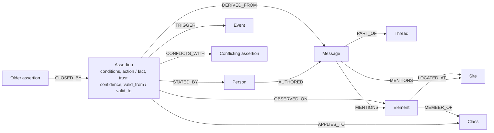

# Technical pipeline: from human message to reusable knowledge

Verified against the local working tree on 8 November 2026, including its uncommitted Dashboard migration. This describes the live Dashboard pipeline; the batch CLI has a separate, simpler build path. All diagrams use Mermaid and are self-contained.

The context layer captures knowledge humans already share, binds it to network entities, and serves it to agents with provenance, trust and time validity. Knowledge becomes available automatically; informational flags and operator overrides do not gate publication. It does not detect faults or diagnose the network.

## End-to-end flow

```mermaid
flowchart TD
    subgraph INGEST["1. Capture and normalize"]
        SLACK["Human Slack message"] --> BRIDGE["SlackBridge: Socket Mode<br/>Filter channel, bots, ignored subtypes,<br/>self-messages and empty text"]
        BRIDGE --> USER["Resolve cached user identity<br/>users.info: display name / real name and title"]
        USER --> THREAD["Match root thread timestamp<br/>Append to LiveThread or create one"]
        OTHER["Dashboard chat / simulator / imported conversations"] --> POST["Dashboard.post_message<br/>Append Message and emit events"]
        THREAD --> POST
    end

    subgraph SCHEDULE["2. Schedule a whole-thread job"]
        POST --> IDLE["Reset idle timer<br/>Configured default: 8 seconds"]
        IDLE --> LOCK["Launch job and acquire shared asyncio lock<br/>Re-run if messages arrive during processing"]
        LOCK --> LISTEN["Listen: LiveThread to core Thread"]
    end

    subgraph UNDERSTAND["3. Understand and verify"]
        LISTEN --> EXTRACT["Understand: structured ExtractedItem list<br/>Full conversation + known topics<br/>LLM extraction or scripted/cache mode"]
        EXTRACT --> CRITIC["Optional critic hook<br/>Normalized evidence-quote check<br/>LLM: keep / downgrade / reject"]
        CRITIC --> HUMAN["Exclude items attributed to the ops agent<br/>or citing only its announcements"]
    end

    subgraph LINK["4. Bind precisely"]
        HUMAN --> VALIDATE["Deterministic Linker<br/>Confidence threshold and author verification<br/>Inventory IDs / aliases + textual mentions<br/>Class specificity and membership checks"]
        INV[("Inventory: elements, sites, aliases")] --> VALIDATE
        VALIDATE --> BOUND{"Valid applies_to binding?"}
        BOUND -- No --> SKIP["Abstain: no assertion stored"]
        BOUND -- Yes --> ASSERT["ContextAssertion<br/>applies_to / observed_on / trigger<br/>Conditions, action or fact, sources,<br/>trust, confidence, valid_from"]
    end

    subgraph STORE["5. Retract, store and merge"]
        ASSERT --> RETRACT["Retract this thread's previous source refs<br/>Delete assertions left without sources<br/>Restore lifecycle consistency"]
        HUMAN -. "Even with zero linked items" .-> RETRACT
        RETRACT --> EXACT["ContextStore.add_assertion<br/>Merge same knowledge or allocate ctx ID"]
        EXACT --> DEDUPE["Optional near-duplicate folding for new assertions<br/>Scope + contradiction guards<br/>Exact / words / cached embeddings<br/>Default similarity threshold: 0.90"]
    end

    subgraph LIFECYCLE["6. Reconcile and learn"]
        DEDUPE --> JUDGE["Optional judge: new assertions only<br/>Up to 8 neighbours by network scope<br/>supports / contradicts / supersedes / unrelated<br/>Apply deterministic safety checks"]
        JUDGE --> OUTCOME["Optional passive outcome hook<br/>Evaluate pending applications in this thread<br/>Record worked / failed evidence once"]
        OUTCOME --> RECON["Reconcile when lifecycle is enabled<br/>Same-topic invalidation + full reach coverage<br/>Close older knowledge or retain conflicts"]
        RECON --> LIVE[("Live ContextStore<br/>Assertions + network binding graph")]
    end

    LIVE --> READ["REST / MCP / agent retrieval<br/>Entity, class and site scope + validity<br/>Condition checks and provenance"]
    LIVE --> GRAPH["On-demand KnowledgeGraph.build<br/>NetworkX projection from store + threads<br/>Graph API, provenance and exports"]
    READ --> APPLY["Agent uses knowledge on a similar case<br/>Record application; optionally post announcement"]
    APPLY --> FEEDBACK["Later human reply or agent observation<br/>Updates outcome ledger and trust / track record"]
    FEEDBACK -. "Human replies enter the same pipeline" .-> POST
    FEEDBACK -. "Observation feedback" .-> LIVE
```



The five recorded pipeline stages remain **listen → understand → link → store → reconcile**. Critic and ops-message filtering run in `after_understand`; judge and passive thread outcomes run in `after_store`. The full graph projection is a read-time view, not a sixth processing stage. Retrieval reads the context store directly; building the full graph is not required before an agent can use knowledge.

## Processing sequence

```mermaid
sequenceDiagram
    autonumber
    actor Human as Specialist
    participant Slack as SlackBridge
    participant DB as Dashboard
    participant Proc as Processor
    participant Extract as Extractor
    participant Critic as Critic hook
    participant Link as Deterministic Linker
    participant Store as ContextStore
    participant Judge as Judge hook
    participant Outcome as Outcome hook
    participant KG as Graph API

    Human->>Slack: Operational knowledge in a message / reply
    Slack->>Slack: Filter event; resolve identity; correlate thread
    Slack->>DB: post_message(..., mirror=False)
    DB->>Proc: request(thread_id)
    Note over DB,Proc: Reset idle timer (configured default 8 s)
    Proc->>Proc: Acquire shared lock; create job; snapshot thread
    Proc->>Extract: extract(thread, known_topics)
    Extract-->>Proc: ExtractedItem list
    opt Critic enabled and LLM configured; not seed bootstrap
        Proc->>Critic: Check quoted evidence and review scope / support
        Critic-->>Proc: Kept or downgraded items; rejected items removed
    end
    Proc->>Proc: Remove ops-agent-derived items
    loop Each remaining item
        Proc->>Link: link(item, thread)
        Link-->>Proc: Assertion + classes, or abstention notes
    end
    Proc->>Store: Retract previous sources for this thread
    loop Each linked result
        Proc->>Store: Add class; add_assertion
        Store-->>Proc: Existing merged assertion or new assertion
        opt New assertion and use_dedupe
            Proc->>Store: Guarded near-duplicate merge into older knowledge
        end
    end
    opt Judge enabled and LLM configured; not seed bootstrap
        Proc->>Judge: Compare remaining new assertions with scope neighbours
        Judge->>Store: Apply safe closures, conflicts or confirmations / merges
    end
    opt Outcome loop enabled; pending applications in thread
        Proc->>Outcome: Evaluate later human replies
        Outcome->>Store: Settle evidence, trust and outcome ledger once
    end
    opt Lifecycle enabled
        Proc->>Store: reconcile(new assertions)
    end
    Proc->>DB: Finish job; collect informational flags; emit changes
    Note over DB,Store: No human approval gate
    opt Client requests graph
        KG->>DB: Read store and available threads
        KG->>KG: KnowledgeGraph.build (NetworkX)
        KG-->>Human: Graph with topology, knowledge and provenance
    end
```

## Knowledge graph relationships



`APPLIES_TO` may target an element, class or site. `OBSERVED_ON` records evidence on an element or site; it does not spread the advice to other equipment at that site or in that class. Conflicts are stored on both assertions, but the projection emits one directed edge per conflicting pair. If cited messages are unavailable, `DERIVED_FROM` falls back to the source thread.

## Changes from the previous diagram

| Previous description | Current implementation |
| --- | --- |
| `dashboard/`, `Dashboard` | `dashboard/`, `Dashboard` in the current working tree |
| Default 2-second debounce | Dashboard initialization uses `DASHBOARD_IDLE_SECONDS`, default **8 seconds**; runtime settings can override it |
| Quote checked verbatim | Quote comparison normalizes whitespace, case and smart quotes; missing legacy quotes pass. Unmatched quotes receive a ×0.7 confidence penalty when the critic completes successfully |
| Every extraction uses an LLM | `auto`, `llm` and scripted/cache paths; auto mode can fall back to scripted answers |
| Store deduplication only | Exact store merge followed by optional guarded near-duplicate folding; default threshold **0.90** |
| Judge directly followed by reconcile | Judge then passive outcome processing in `after_store`, followed by deterministic reconcile |
| Invalidation based only on reach | Deterministic reconcile also requires the same topic and older knowledge; partial reach leaves the older rule open |
| Graph projection runs after every job | Full NetworkX graph is rebuilt on request from current store and threads; Neo4j is not a required live-pipeline step |
| Pipeline ends at graph creation | Context is retrieved by agents, with applications and passive feedback feeding trust and outcome history |

Critic and judge are optional, remain quiet without a configured LLM or during seed bootstrap, and do not block a job on model failure. Lifecycle and dedupe have separate settings. Failed feedback does not automatically delete knowledge. The batch CLI in `pipeline.py` does not run the Dashboard hook chain.

## Implementation references

- Capture and scheduling: [Slack bridge](../src/context_layer/dashboard/slack_bridge.py), [Dashboard state](../src/context_layer/dashboard/state.py), [processor](../src/context_layer/dashboard/processor.py), [configuration defaults](../src/context_layer/config.py).
- Extraction and binding: [understand](../src/context_layer/understand.py), [critic](../src/context_layer/critic.py), [linker](../src/context_layer/link.py), [shared contracts](../src/context_layer/models.py).
- Storage and lifecycle: [store](../src/context_layer/store.py), [near-duplicate folding](../src/context_layer/dashboard/dedupe.py), [judge](../src/context_layer/judge.py), [outcomes](../src/context_layer/outcome.py), [reconcile](../src/context_layer/mvp/lifecycle.py).
- Projection and consumption: [knowledge graph](../src/context_layer/graph/kg.py), [graph schema](../src/context_layer/graph/schema.py), [Dashboard routes](../src/context_layer/dashboard/routes.py), [MCP tools](../src/context_layer/mcp_server.py).
